# M1 / Contact DRC Demo

Side-by-side **KLayout** and **Calibre** DRC on the same Metal1 / Contact test layout — GOOD pass / BAD fail (same pattern as [`../lvs/`](../lvs/)).

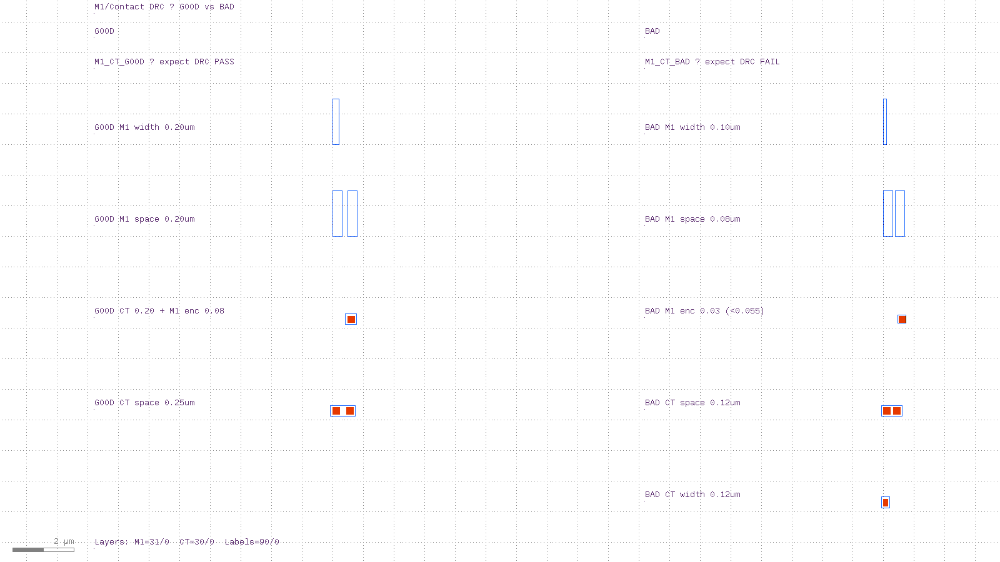

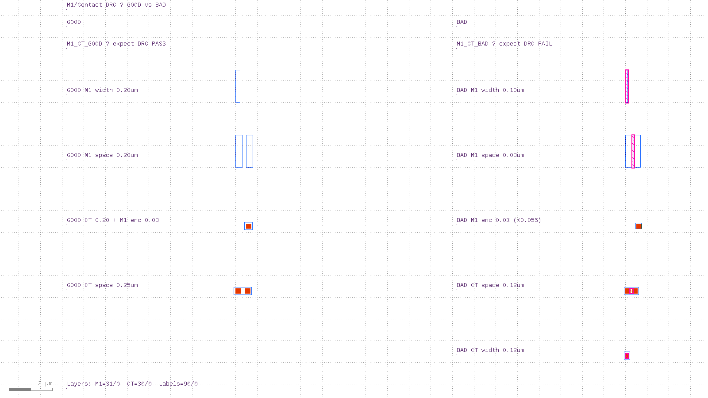

| Cell | Layout | Expected |
|------|--------|----------|
| `M1_CT_GOOD` | Passing width / space / enclosure | **PASS** (0 violations) |
| `M1_CT_BAD` | One intentional fail per rule | **FAIL** (8 markers) |
| `M1_CT_DRC_DEMO` | Both (for viewing / Calibre) | FAIL (BAD subcell) |

| Rule | Value | KLayout | Calibre |
|------|-------|---------|---------|
| M1 min width | 0.14 µm | `M1.min_width` | `M1_MIN_WIDTH` |
| M1 min space | 0.14 µm | `M1.min_space` | `M1_MIN_SPACE` |
| CT min width | 0.16 µm | `CT.min_width` | `CT_MIN_WIDTH` |
| CT min space | 0.18 µm | `CT.min_space` | `CT_MIN_SPACE` |
| M1 over CT enclosure | 0.055 µm | `M1.over_CT.enclosure` | `M1_OVER_CT_ENCLOSURE` |

**Layers (screenshot colors):** M1 **31/0** blue · CT **30/0** red-orange · labels **90/0** purple · DRC markers magenta

**Expected on BAD / DEMO:** KLayout → **8** markers (enclosure = 4 edge-pairs). Calibre on DEMO → **6** results (enclosure = 2).

Sibling demos: [`../lvs/`](../lvs/) (NMOS LVS) · [`../pex/`](../pex/) (M1 R extraction).

---

## Quick start

```bash
cd drc

# KLayout — GOOD → PASS, BAD → FAIL
./run_klayout_drc.sh
./run_klayout_drc.sh --good
./run_klayout_drc.sh --bad

./view_klayout_drc.sh          # DEMO + markers
./view_klayout_drc.sh --bad

# Calibre (needs calibre.env — see below)
./view_calibre_drc.sh          # UI: DESIGNrev → DRC → RVE
./run_calibre_drc.sh           # batch on M1_CT_DRC_DEMO

./run_clean.sh
```

Requires [KLayout](https://www.klayout.de/) on `PATH` (`../scripts/install-klayout.sh`).

```bash
klayout -b \
  -rd input=m1_contact_demo.gds \
  -rd cell=M1_CT_GOOD \
  -rd report=m1_contact_good.lyrdb \
  -r m1_contact.drc
```

---

## Files

| File | Role |
|------|------|
| `generate_layout.rb` | Builds `m1_contact_demo.gds` (GOOD + BAD + DEMO) |
| `m1_contact_demo.gds` | Test layout |
| `m1_contact.drc` | KLayout rule deck (`puts DRC PASS/FAIL`) |
| `run_klayout_drc.sh` | Generate + run GOOD/BAD/DEMO |
| `view_klayout_drc.sh` | `klayout gds -m lyrdb` |
| `m1_contact.calibre.svrf` | Calibre rules only (no LAYOUT PATH) |
| `run_calibre_drc.sh` | Batch Calibre (writes temp `INCLUDE` run deck) |
| `run_drc_in_calibredrv.tcl` | UI: paths from open layout (`$L file` / `topcell`) |
| `view_calibre_drc.sh` | Launch calibredrv Tcl + RVE |
| `calibre.env.example` | Site `MGC_HOME` / `MGLS_LICENSE_FILE` template |
| `run_clean.sh` | Delete reports / logs (`--gds` also removes GDS) |

Generated (gitignored): `m1_contact_{good,bad,demo}.{lyrdb,log}`, `m1_contact.lyrdb`, `m1_contact.calibre.{rdb,rep,log}`, `.calibre_run/`, `calibredrc/`, `calibre.env`

---

## Good vs bad (overview)

| GOOD (`M1_CT_GOOD`) | BAD (`M1_CT_BAD`) |
|:-------------------:|:-----------------:|
| 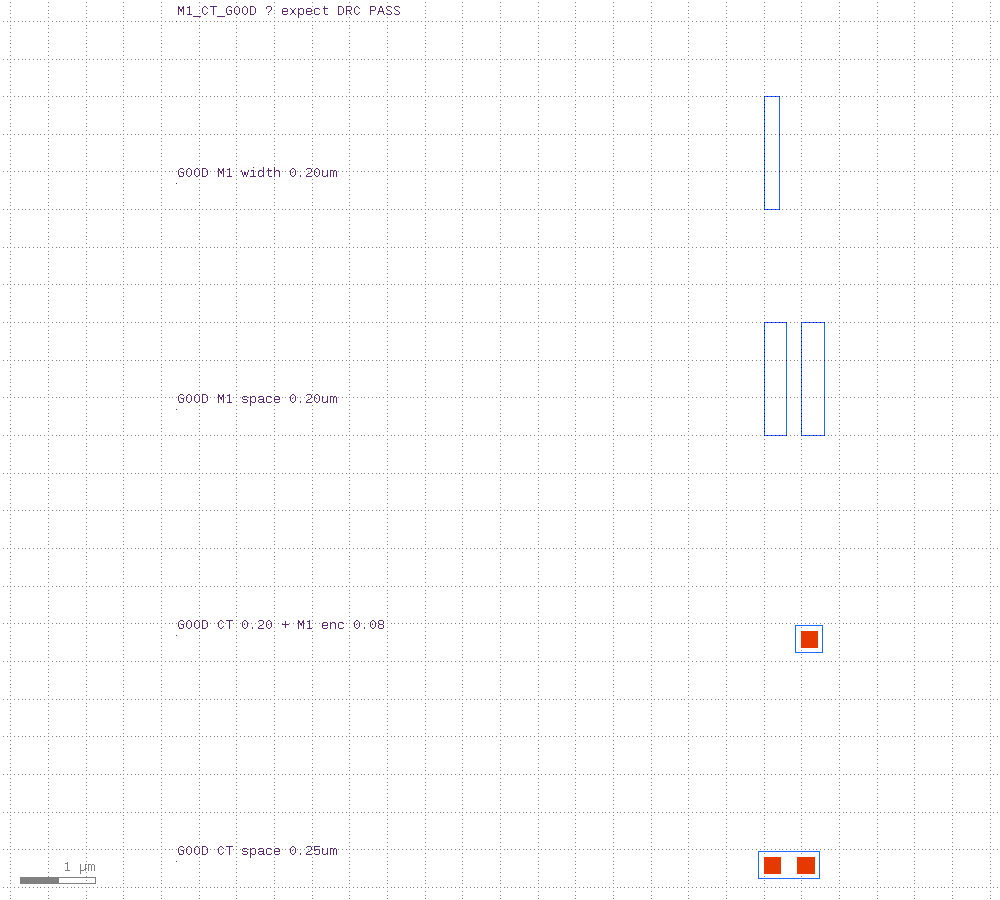 | 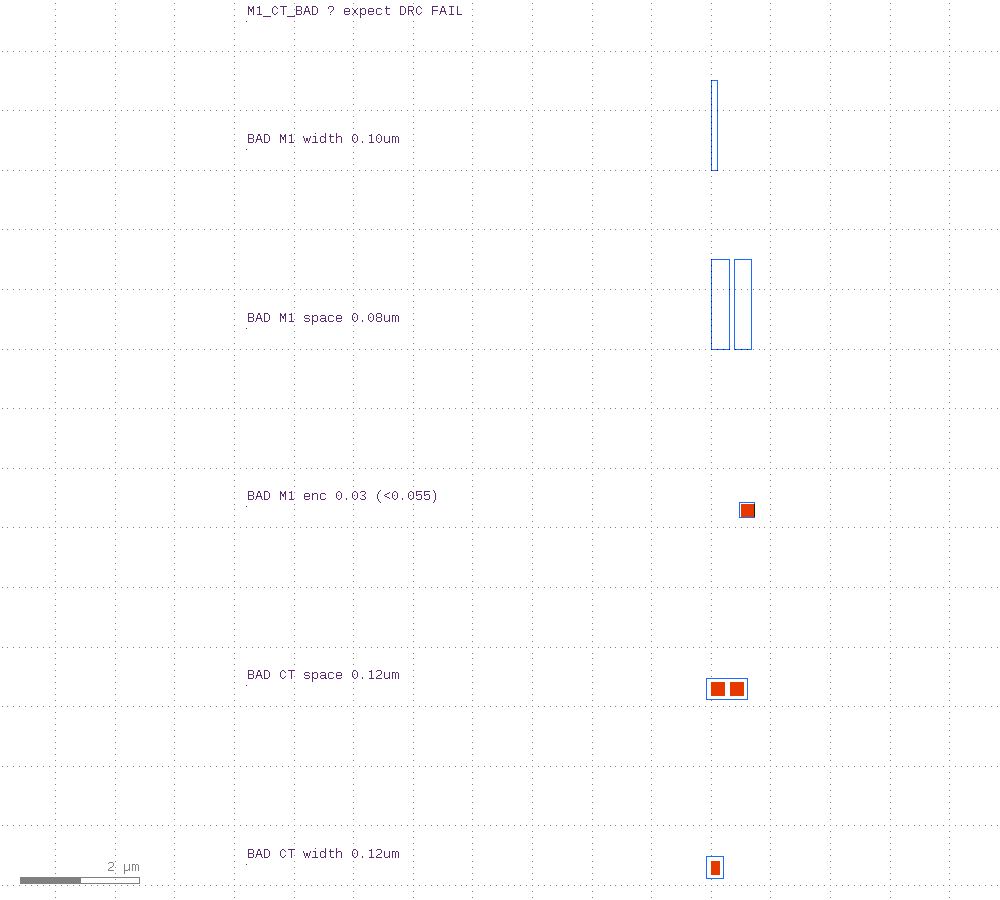 |
| All structures meet rules | Thin wire, tight space, weak enc, tight CT, tiny CT |

---

## Per-rule zoom (rulers + error markers)

Each shot is zoomed to one structure. Dimension rulers show the measured value; BAD cases also highlight DRC markers (magenta).

### M1 min width (limit 0.14 µm)

| GOOD 0.20 µm | BAD 0.10 µm |
|:------------:|:-----------:|
| 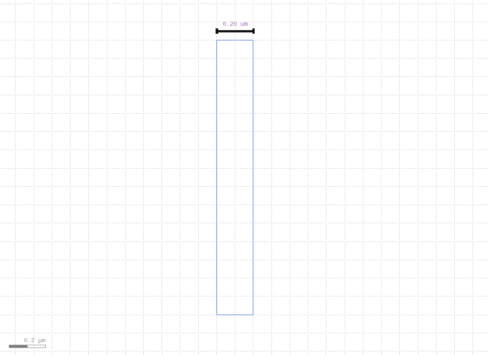 | 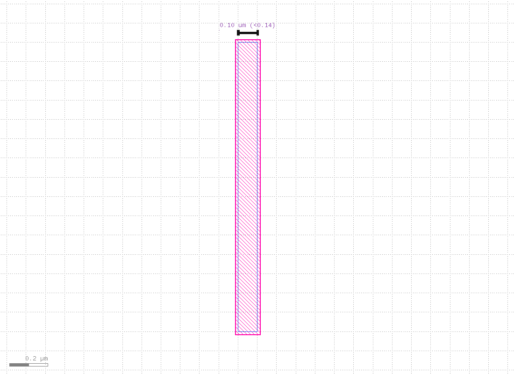 |

### M1 min space (limit 0.14 µm)

| GOOD 0.20 µm | BAD 0.08 µm |
|:------------:|:-----------:|
| 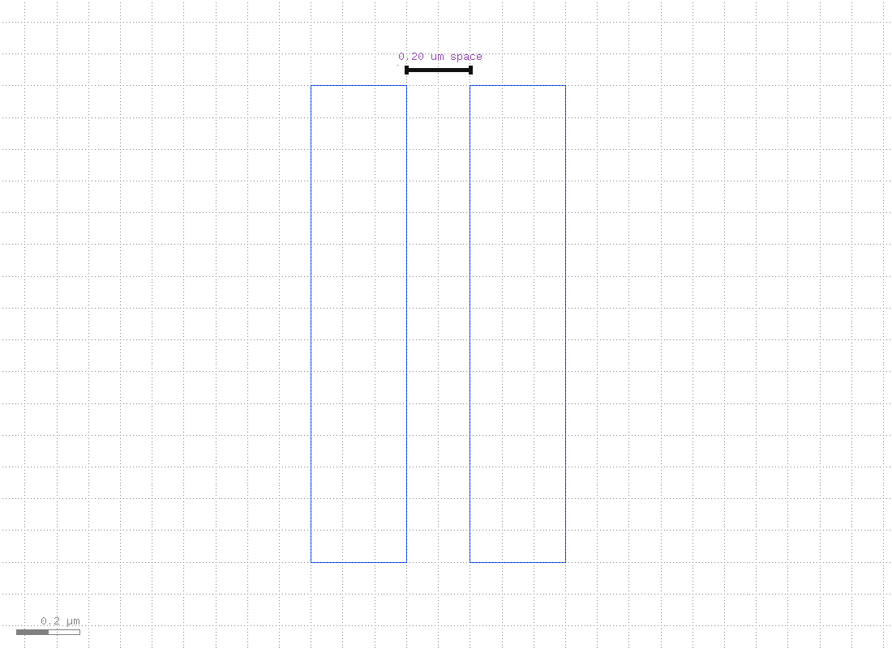 | 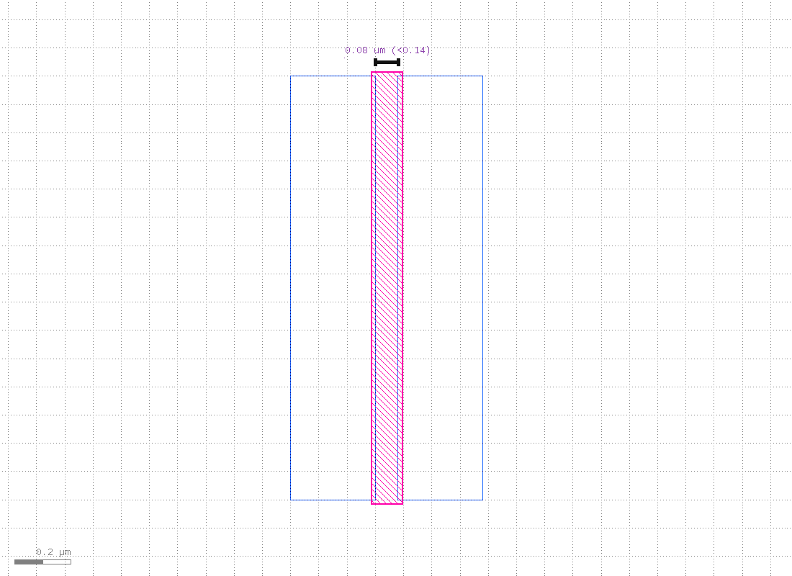 |

### M1 over CT enclosure (limit 0.055 µm)

| GOOD 0.08 µm | BAD 0.03 µm |
|:------------:|:-----------:|
| 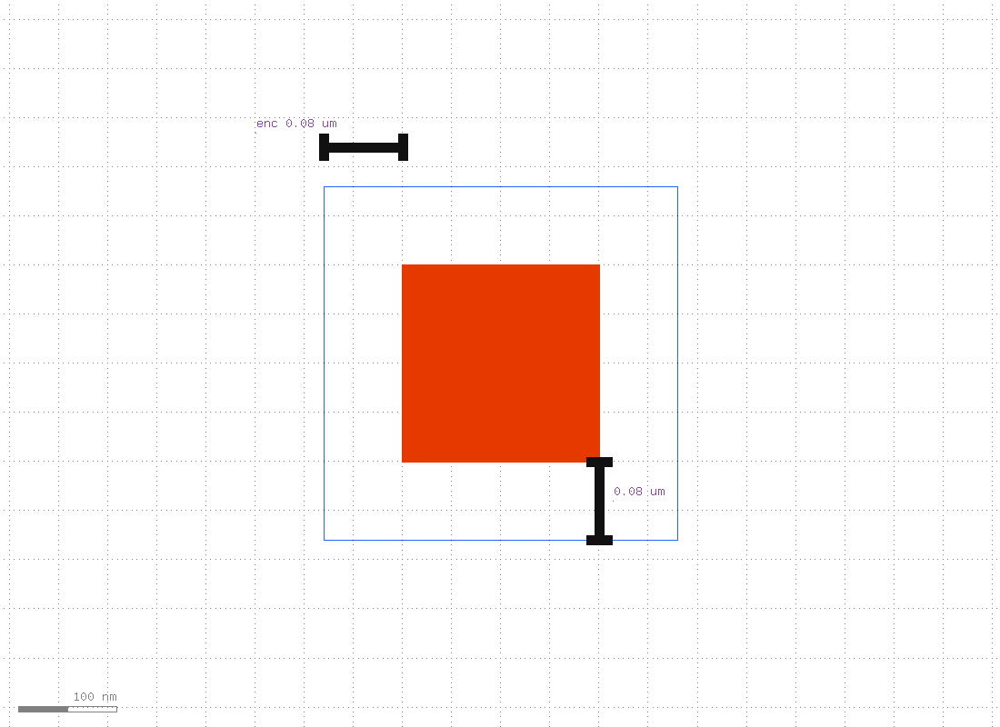 | 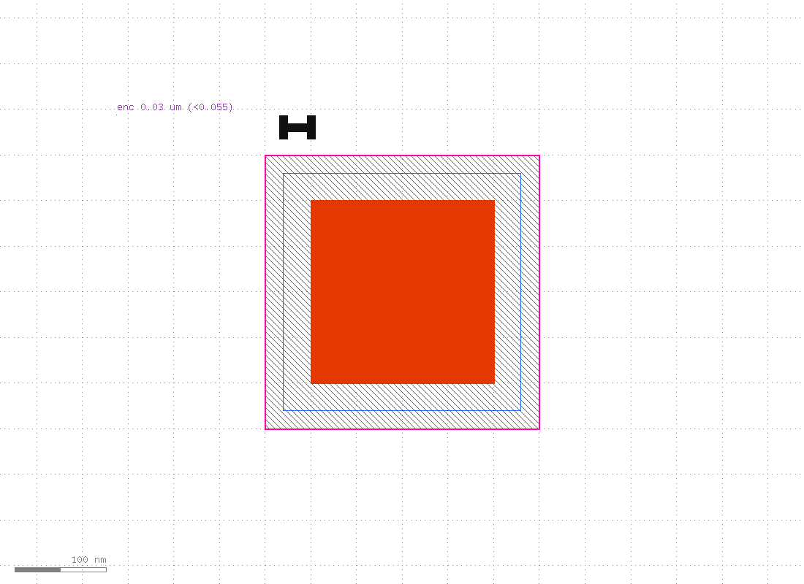 |

### CT min space (limit 0.18 µm)

| GOOD 0.25 µm | BAD 0.12 µm |
|:------------:|:-----------:|
| 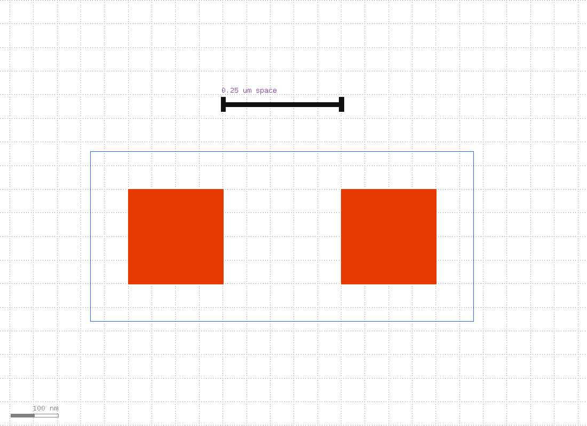 | 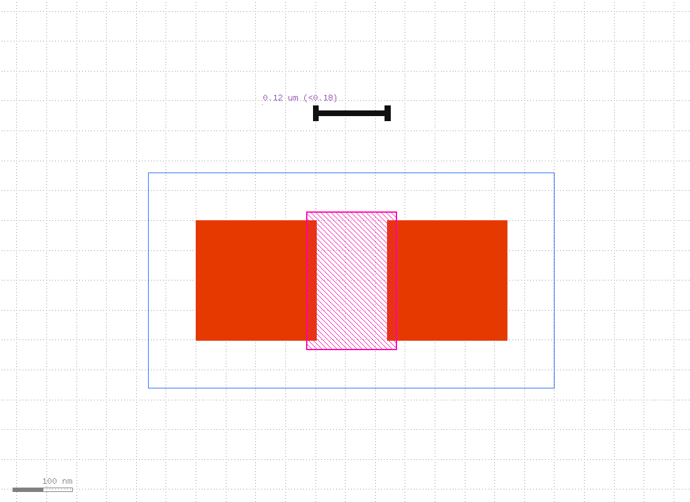 |

### CT min width (limit 0.16 µm)

| BAD 0.12 µm |
|:-----------:|
| 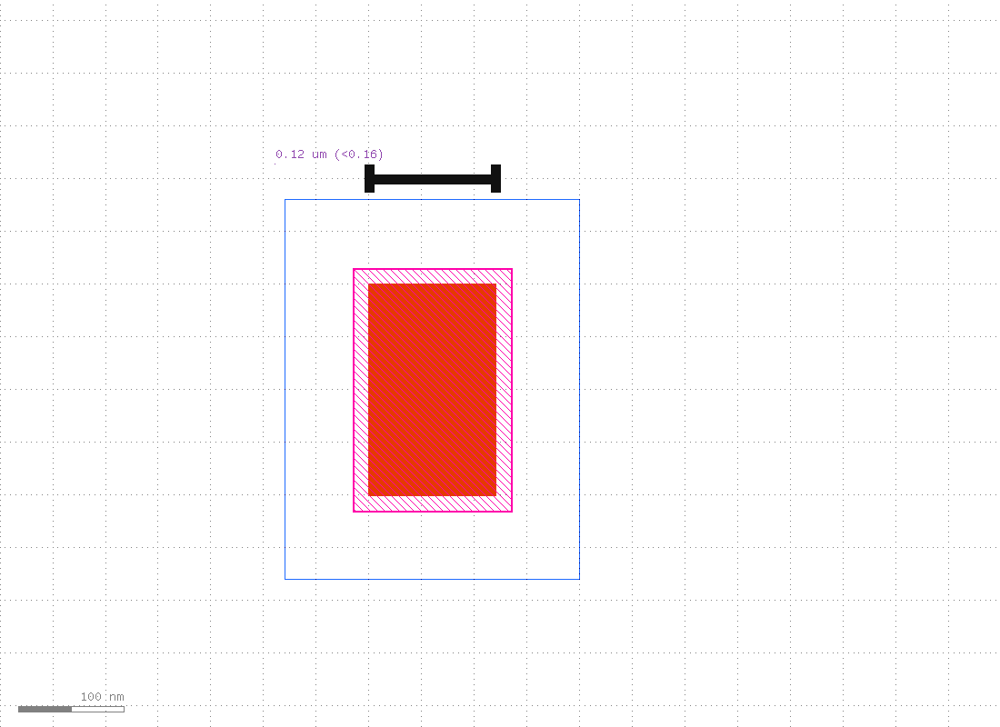 |

---

## KLayout vs Calibre

### Setup

**KLayout** — Ruby DSL; report linked to source GDS for the GUI:

```ruby
source($input, $cell || "M1_CT_DRC_DEMO")
report("M1 / Contact DRC demo", "m1_contact.lyrdb", cell_name)
def_output.rdb.original_file = $input
metal1  = input(31, 0)
contact = input(30, 0)
```

**Calibre** — SVRF rules file has **no** layout/RDB paths. Batch / DESIGNrev write a tiny run deck that `INCLUDE`s this file (or Calibre Interactive fills paths in the GUI). Topcell: `M1_CT_DRC_DEMO`.

```svrf
LAYER M1 31 0
LAYER CT 30 0
```

| | KLayout | Calibre |
|---|---------|---------|
| Language | Ruby (`.drc`) | SVRF (`.svrf`) |
| Layer | `input(31, 0)` | `LAYER M1 31 0` |
| Units | `0.14.um` | `0.14` (µm) |
| Output | `.output("cat", "desc")` | named rule blocks → RDB |
| Viewer | `klayout gds -m report.lyrdb` | `calibredrv gds -rve -drc report.rdb` |

### Rule mapping (matches the files in this folder)

| Check | KLayout | Calibre |
|-------|---------|---------|
| Min width | `metal1.width(0.14.um)` | `INT M1 < 0.14 ABUT < 90 SINGULAR` |
| Min space | `metal1.space(0.14.um)` | `EXT M1 < 0.14 ABUT < 90 SINGULAR` |
| Enclosure | `metal1.enclosing(contact, 0.055.um)` | `CT_GROWN = SIZE CT BY 0.055` then `CT_GROWN NOT INSIDE M1` |
| CT width / space | `contact.width` / `.space` | `INT CT` / `EXT CT` |

Same-layer Calibre spacing uses **one** layer argument (`EXT M1`, not `EXT M1 M1`). Enclosure here uses grow-and-inside (robust on Calibre 2019); KLayout uses `enclosing`.

### Full snippets

```ruby
# KLayout — m1_contact.drc
metal1.width(0.14.um).output("M1.min_width", "...")
metal1.space(0.14.um).output("M1.min_space", "...")
contact.width(0.16.um).output("CT.min_width", "...")
contact.space(0.18.um).output("CT.min_space", "...")
metal1.enclosing(contact, 0.055.um).output("M1.over_CT.enclosure", "...")
```

```svrf
// Calibre — m1_contact.calibre.svrf
M1_MIN_WIDTH { INT M1 < 0.14 ABUT < 90 SINGULAR }
M1_MIN_SPACE { EXT M1 < 0.14 ABUT < 90 SINGULAR }
CT_GROWN = SIZE CT BY 0.055
M1_OVER_CT_ENCLOSURE { CT_GROWN NOT INSIDE M1 }
```

### Calibre setup (this server)

```bash
cp calibre.env.example calibre.env   # already configured on this host if present
# MGC_HOME=/data1/eda/eda/mentor/aoi_cal_2019.2_26.18
# MGLS_LICENSE_FILE=/data1/eda/eda/mentor/mentor2019.dat
./run_calibre_drc.sh --setup-help
```

---

## Screenshots

```bash
../scripts/run_capture_screenshots.sh   # regenerate GDS + DRC + all PNGs
```

| File | Content |
|------|---------|
| [`../screenshots/drc_m1_contact_layout.png`](../screenshots/drc_m1_contact_layout.png) | GOOD + BAD side by side |
| [`../screenshots/drc_m1_contact_good.png`](../screenshots/drc_m1_contact_good.png) | Passing structures |
| [`../screenshots/drc_m1_contact_bad.png`](../screenshots/drc_m1_contact_bad.png) | Failing structures |
| [`../screenshots/drc_m1_contact_with_markers.png`](../screenshots/drc_m1_contact_with_markers.png) | DEMO + DRC markers |
| `drc_case_*.png` | Per-rule zoom with rulers / markers (see above) |

---

## See also

- [`../docs/DRC.md`](../docs/DRC.md) — KLayout DRC command reference  
- [`../lvs/`](../lvs/) — NMOS LVS demo  
- [`../pex/`](../pex/) — M1 resistor PEX  
- [`../scripts/install-klayout.sh`](../scripts/install-klayout.sh)
