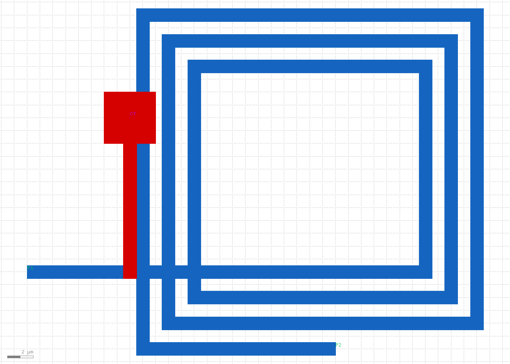

# RESULT — inductor/3 — square_3p_ct_l2

## Summary

| Field | Value |
|-------|-------|
| Run | `inductor/3` |
| Name | square_3p_ct_l2 |
| Shape | square |
| Ports / role | **3** (P1 / P2 / CT) / inductor |
| Layers | **2** (M1 + M2 CT tap) |
| Width / space | 1.0 µm / 1.0 µm |
| Turns | 3.0 |
| Inner radius | 16.0 µm |
| DRC | **PASS** (0 violations) |
| LVS | **PASS** (P1–CT–P2 connectivity) |
| openEMS | **SKIPPED** (analytic placeholder) |

Verdict: New **3-port center-tap** topology vs runs 1–2 (both 2-port). CT on M2 with via; layout verified.

## Layout screenshot



**Layer colors:** M1 **blue** · M2 **red** · VIA **yellow** · M1 labels **green** · M2 labels **magenta**

## Diversity vs existing database

| Run | shape | ports | role | layers |
|-----|-------|-------|------|--------|
| 1 | square | 2 | inductor | 1 |
| 2 | figure8 | 2 | inductor | 1 |
| **3** | square | **3** | inductor | **2** |

(Note: octagon 3-port was attempted first but failed DRC; generator falls back to square geometry for CT until octagon spirals are fixed.)

## Config

```yaml
name: square_3p_ct_l2
cell: IND_SQ_3P
shape: square
ports: 3
role: inductor
n_layers: 2
width_um: 1.0
space_um: 1.0
turns: 3.0
inner_radius_um: 16.0
```

## DRC

- Command: `./inductor/common/run_drc.sh inductor/3`
- Violations: 0
- Log: `drc/inductor.log`

## LVS

- Command: `./inductor/common/run_lvs.sh inductor/3`
- Result: PASS — labels `CT,P1,P2` on one DC net
- Log: `lvs/inductor.log`

## EM (openEMS)

| Metric | Value | Note |
|--------|-------|------|
| L (est.) | ≈ 0.541 nH | analytic |
| Q placeholder | ≈ 23.6 @ 20 GHz | not physical EM |
| f_ref | 2.4 GHz | config |

- Data: `sim/sparams.csv`, `sim/lq.csv`
- Status: `SKIPPED_OPENEMS`

## Files

- `config.yaml`
- `layout/inductor.gds` (cell `IND_SQ_3P`)
- `layout/inductor.png`

## Next steps

- Next unused: `circle` 2p, or **4-port transformer** (`role: transformer`) for stacked M1/M2 windings
- Fix octagon/circle spiral generator for DRC-clean non-square shapes
