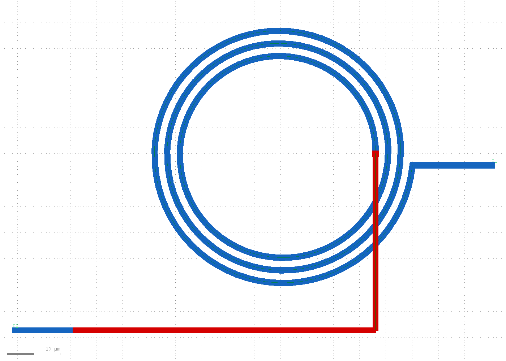
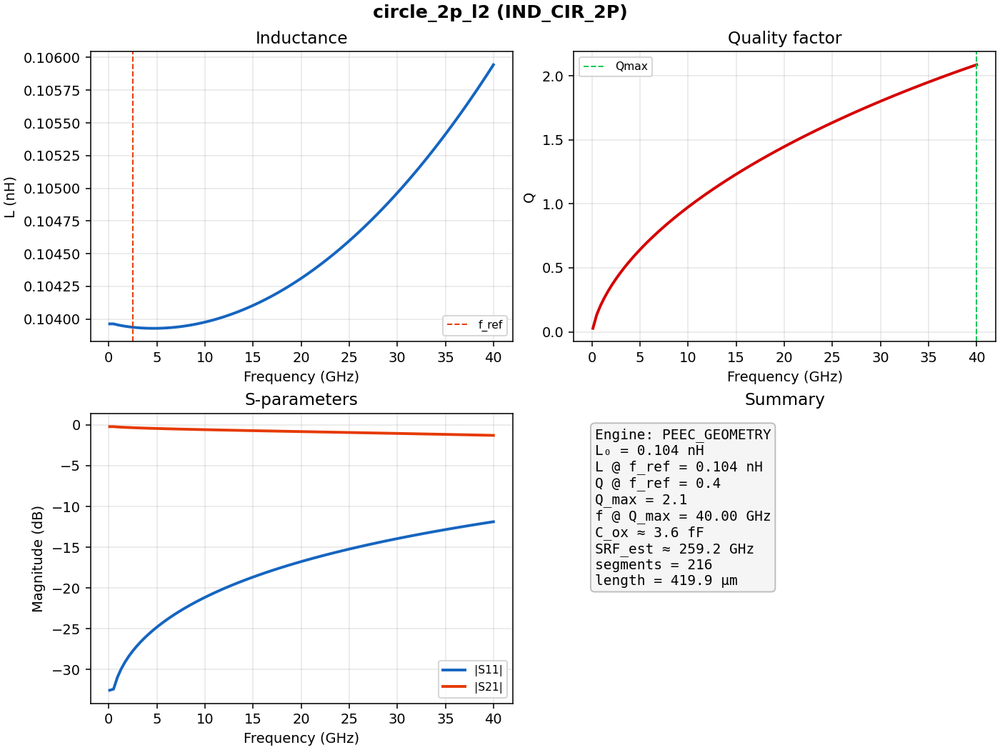

# RESULT — inductor/5 — circle_2p_l2

## Summary

| Field | Value |
|-------|-------|
| Run | `inductor/5` |
| Name | circle_2p_l2 |
| Shape / ports / role | **circle** / **2** / inductor |
| Layers | M1 spiral + M2 underpass (2 vias) |
| Width / space | 1.0 / 1.0 µm |
| Turns / rin | 3.0 / 18.0 µm |
| DRC / LVS / SHORTS | **PASS** / **PASS** / **PASS** |
| EM engine | PEEC_GEOMETRY |
| L₀ | **0.104 nH** |
| Q @ 2.4 GHz | **0.4** |
| Q_max | **2.1** @ 40 GHz |
| SRF_est | ≈ 259 GHz |

Verdict: First **circle** spiral in the database — Path ribbons with pitch×1.20 and via pads matched to Path half-width.

## Layout

**Colors:** M1 blue · M2 red · VIA yellow · labels green / magenta

## EM performance

| Metric | Value |
|--------|-------|
| Segments / length | 216 / 420 µm |
| Engine | PEEC_GEOMETRY (Grover L + skin R + oxide C) |
| Data | `sim/lq.csv`, `sim/sparams.csv`, `sim/summary.json` |

## Diversity

| Run | shape | ports | role |
|-----|-------|------:|------|
| 1 | square | 2 | inductor |
| 2 | figure8 | 2 | inductor |
| 3 | square | 3 | inductor |
| 4 | square | 4 | transformer |
| **5** | **circle** | **2** | inductor |

## Checks

| Check | Result |
|-------|--------|
| DRC | PASS |
| LVS | PASS (`P1,P2`) |
| SHORTS | PASS (single series path) |

## Files

- `config.yaml`, `layout/inductor.gds`, `layout/inductor.png`
- `sim/summary.json`, `sim/performance.png`
