# Inductor BENCHMARK

Auto-generated by `inductor/common/update_benchmark.py` — **9** run(s) — 2026-10-13 09:58 UTC

Regenerate: `python3 inductor/common/update_benchmark.py` or `./inductor/common/run_benchmark.sh`

## Summary leaderboard

| Run | Name | Shape | Ports | Role | DRC | LVS | SHORTS | Engine | L₀ (nH) | L@f_ref (nH) | Q@f_ref | Q_max | SRF (GHz) | Links |
|-----|------|-------|------:|------|-----|-----|--------|--------|--------:|-------------:|--------:|------:|----------:|-------|
| 1 | `square_2p_l1` | square | 2 | inductor | PASS | PASS | PASS | PEEC_GEOMETRY | 0.456 | 0.456 | 2.01 | 9.44 | 130.3 | [RESULT](1/RESULT.md), [layout](1/layout/inductor.png), [EM](1/sim/performance.png) |
| 2 | `figure8_2p_l1` | figure8 | 2 | inductor | PASS | PASS | PASS | PEEC_GEOMETRY | 0.271 | 0.271 | 1.31 | 6.48 | 177.4 | [RESULT](2/RESULT.md), [layout](2/layout/inductor.png), [EM](2/sim/performance.png) |
| 3 | `square_3p_ct_l2` | square | 3 | inductor | PASS | PASS | PASS | PEEC_GEOMETRY | 0.258 | 0.258 | 1.61 | 8.07 | 206.4 | [RESULT](3/RESULT.md), [layout](3/layout/inductor.png), [EM](3/sim/performance.png) |
| 4 | `square_4p_xfmr` | square | 4 | transformer | PASS | PASS | PASS | PEEC_GEOMETRY | 0.296 | 0.296 | 1.70 | 8.41 | 184.5 | [RESULT](4/RESULT.md), [layout](4/layout/inductor.png), [EM](4/sim/performance.png) |
| 5 | `circle_2p_l2` | circle | 2 | inductor | PASS | PASS | PASS | PEEC_GEOMETRY | 0.104 | 0.104 | 0.41 | 2.09 | 259.2 | [RESULT](5/RESULT.md), [layout](5/layout/inductor.png), [EM](5/sim/performance.png) |
| 6 | `octagon_2p_l2` | octagon | 2 | inductor | PASS | PASS | PASS | PEEC_GEOMETRY | 0.343 | 0.343 | 1.14 | 5.37 | 130.6 | [RESULT](6/RESULT.md), [layout](6/layout/inductor.png), [EM](6/sim/performance.png) |
| 7 | `octagon_3p_ct_l2` | octagon | 3 | inductor | PASS | PASS | PASS | PEEC_GEOMETRY | 0.318 | 0.318 | 1.14 | 5.44 | 140.9 | [RESULT](7/RESULT.md), [layout](7/layout/inductor.png), [EM](7/sim/performance.png) |
| 8 | `square_4p_coup_l2` | square | 4 | coupler | PASS | PASS | PASS | PEEC_GEOMETRY | 0.296 | 0.296 | 1.70 | 8.41 | 184.5 | [RESULT](8/RESULT.md), [layout](8/layout/inductor.png), [EM](8/sim/performance.png) |
| 9 | `circle_3p_ct_l2` | circle | 3 | inductor | PASS | PASS | PASS | PEEC_GEOMETRY | 0.090 | 0.089 | 0.39 | 1.98 | 292.8 | [RESULT](9/RESULT.md), [layout](9/layout/inductor.png), [EM](9/sim/performance.png) |

### Champions

| Metric | Winner |
|--------|--------|
| Highest L₀ | **#1** `square_2p_l1` (0.456) |
| Highest Q @ f_ref | **#1** `square_2p_l1` (2.006) |
| Highest Q_max | **#1** `square_2p_l1` (9.442) |
| Highest SRF_est | **#9** `circle_3p_ct_l2` (292.772) |

### Gate status

| Gate | Pass rate |
|------|----------:|
| DRC | 9/9 |
| LVS | 9/9 |
| SHORTS | 9/9 |
| EM summary | 9/9 |

### Design diversity

| Run | (shape, ports, role) | W/S (µm) | turns | rin (µm) | t_metal (µm) |
|-----|----------------------|---------:|------:|---------:|-------------:|
| 1 | `(square, 2, inductor)` | 1.0/1.0 | 3.5 | 20.0 | 3.0 |
| 2 | `(figure8, 2, inductor)` | 1.0/1.0 | 2.5 | 12.0 | 3.0 |
| 3 | `(square, 3, inductor)` | 1.0/1.0 | 3.0 | 16.0 | 3.0 |
| 4 | `(square, 4, transformer)` | 1.0/1.0 | 3.0 | 18.0 | 3.0 |
| 5 | `(circle, 2, inductor)` | 1.0/1.0 | 3.0 | 18.0 | 3.0 |
| 6 | `(octagon, 2, inductor)` | 1.0/1.0 | 3.0 | 18.0 | 3.0 |
| 7 | `(octagon, 3, inductor)` | 1.0/1.0 | 3.0 | 16.0 | 3.0 |
| 8 | `(square, 4, coupler)` | 1.0/1.0 | 3.0 | 18.0 | 3.0 |
| 9 | `(circle, 3, inductor)` | 1.0/1.0 | 3.0 | 16.0 | 3.0 |

## Detail by run

### Run 1 — `square_2p_l1`

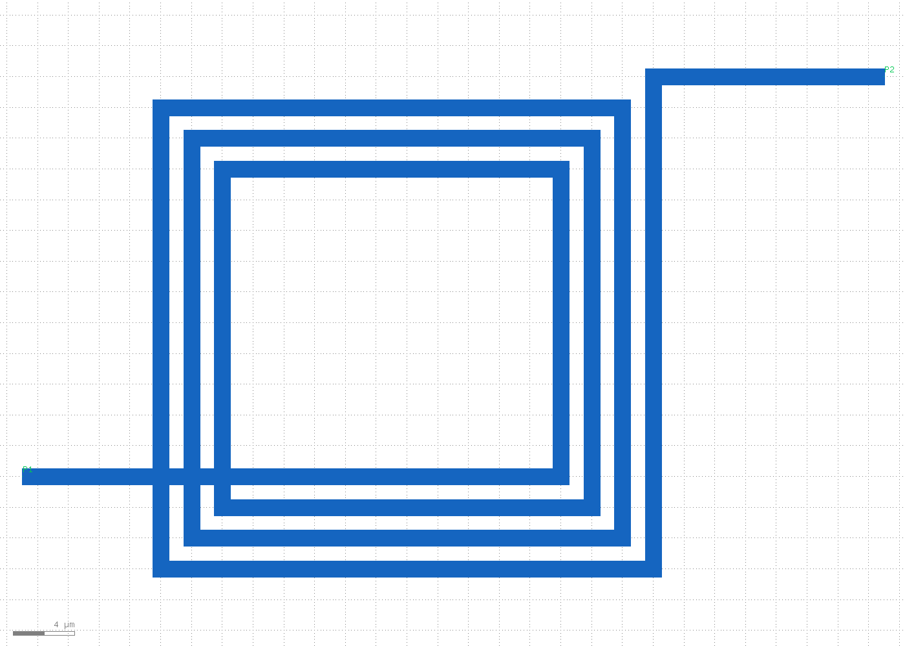

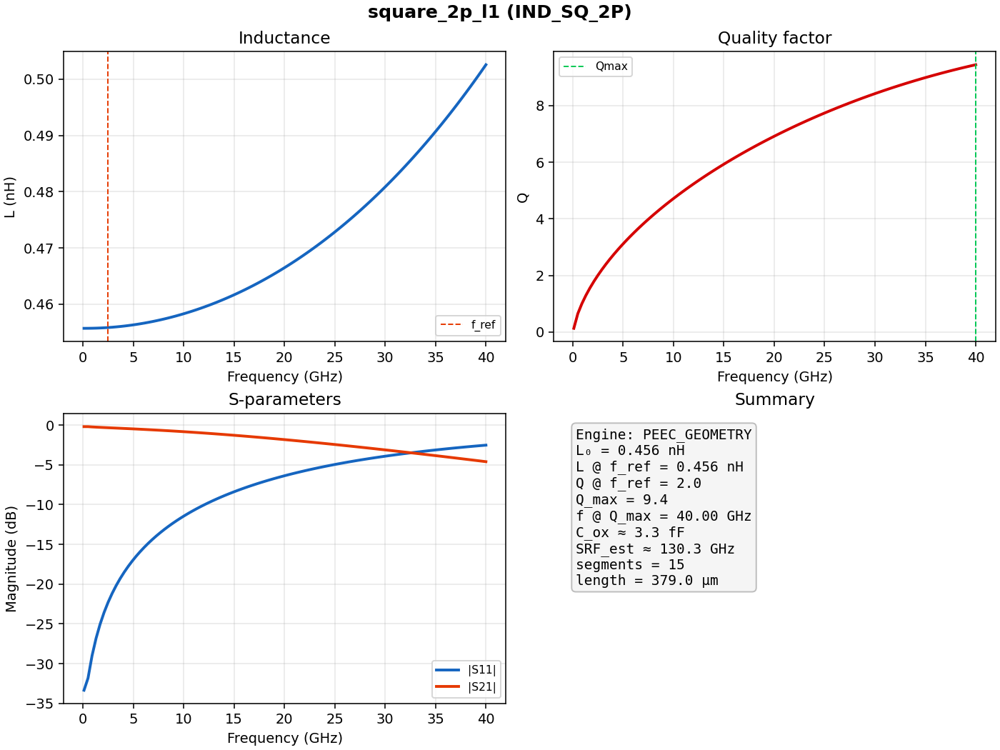

| Field | Value |
|-------|-------|
| Cell | `IND_SQ_2P` |
| Shape / ports / role | square / 2 / inductor |
| Width / space | 1.0 / 1.0 µm |
| Turns / rin | 3.5 / 20.0 µm |
| DRC / LVS / SHORTS | PASS / PASS / PASS |
| EM engine | PEEC_GEOMETRY |
| L₀ | 0.456 nH |
| L @ f_ref | 0.456 nH |
| Q @ f_ref | 2.01 |
| Q_max | 9.44 @ 40.00 GHz |
| C_ox | 3.27 fF |
| SRF_est | 130.3 GHz |
| Segments / length | 15 / 379.0 µm |
| RESULT | [1/RESULT.md](1/RESULT.md) |

### Run 2 — `figure8_2p_l1`

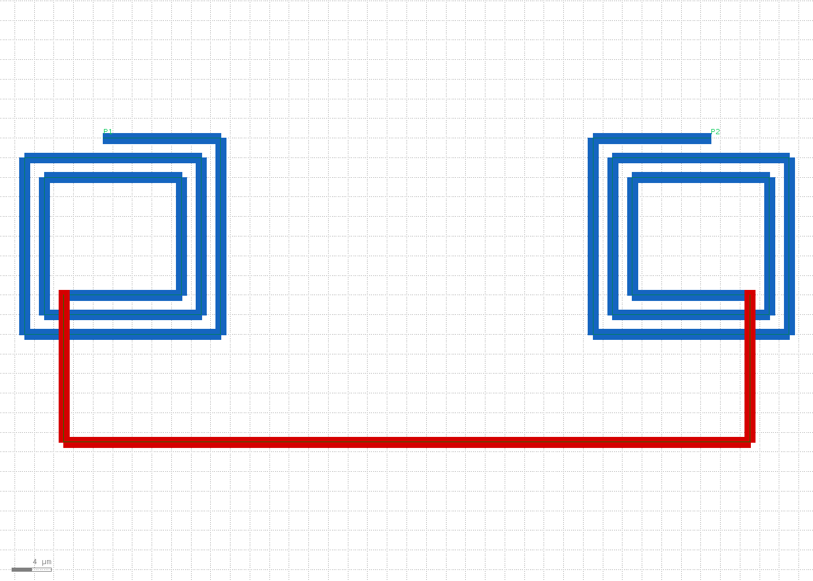

| Field | Value |
|-------|-------|
| Cell | `IND_F8_2P` |
| Shape / ports / role | figure8 / 2 / inductor |
| Width / space | 1.0 / 1.0 µm |
| Turns / rin | 2.5 / 12.0 µm |
| DRC / LVS / SHORTS | PASS / PASS / PASS |
| EM engine | PEEC_GEOMETRY |
| L₀ | 0.271 nH |
| L @ f_ref | 0.271 nH |
| Q @ f_ref | 1.31 |
| Q_max | 6.48 @ 40.00 GHz |
| C_ox | 2.97 fF |
| SRF_est | 177.4 GHz |
| Segments / length | 22 / 344.0 µm |
| RESULT | [2/RESULT.md](2/RESULT.md) |

### Run 3 — `square_3p_ct_l2`

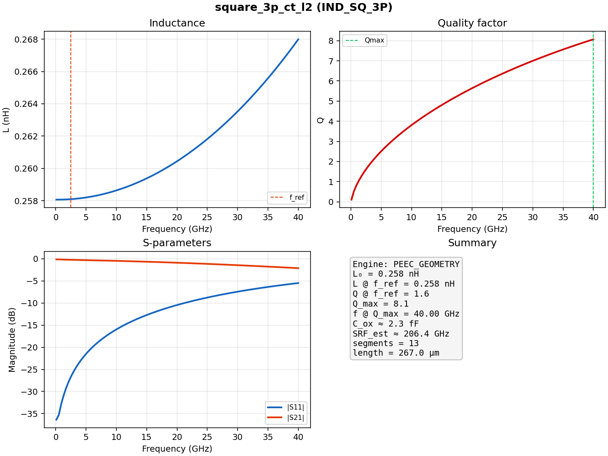

| Field | Value |
|-------|-------|
| Cell | `IND_SQ_3P` |
| Shape / ports / role | square / 3 / inductor |
| Width / space | 1.0 / 1.0 µm |
| Turns / rin | 3.0 / 16.0 µm |
| DRC / LVS / SHORTS | PASS / PASS / PASS |
| EM engine | PEEC_GEOMETRY |
| L₀ | 0.258 nH |
| L @ f_ref | 0.258 nH |
| Q @ f_ref | 1.61 |
| Q_max | 8.07 @ 40.00 GHz |
| C_ox | 2.30 fF |
| SRF_est | 206.4 GHz |
| Segments / length | 13 / 267.0 µm |
| RESULT | [3/RESULT.md](3/RESULT.md) |

### Run 4 — `square_4p_xfmr`

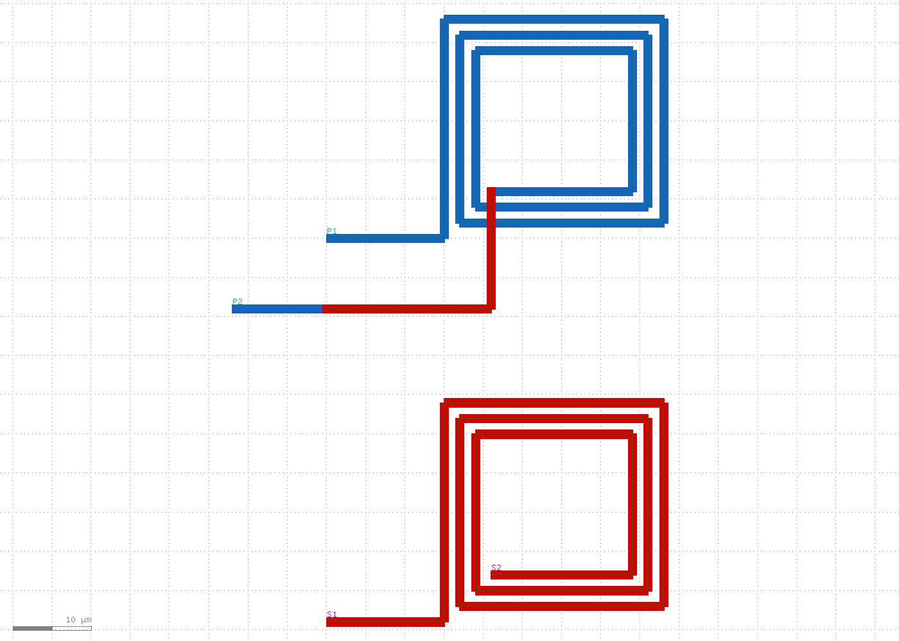

| Field | Value |
|-------|-------|
| Cell | `XFMR_SQ_4P` |
| Shape / ports / role | square / 4 / transformer |
| Width / space | 1.0 / 1.0 µm |
| Turns / rin | 3.0 / 18.0 µm |
| DRC / LVS / SHORTS | PASS / PASS / PASS |
| EM engine | PEEC_GEOMETRY |
| L₀ | 0.296 nH |
| L @ f_ref | 0.296 nH |
| Q @ f_ref | 1.70 |
| Q_max | 8.41 @ 40.00 GHz |
| C_ox | 2.51 fF |
| SRF_est | 184.5 GHz |
| Segments / length | 13 / 291.0 µm |
| RESULT | [4/RESULT.md](4/RESULT.md) |

### Run 5 — `circle_2p_l2`

| Field | Value |
|-------|-------|
| Cell | `IND_CIR_2P` |
| Shape / ports / role | circle / 2 / inductor |
| Width / space | 1.0 / 1.0 µm |
| Turns / rin | 3.0 / 18.0 µm |
| DRC / LVS / SHORTS | PASS / PASS / PASS |
| EM engine | PEEC_GEOMETRY |
| L₀ | 0.104 nH |
| L @ f_ref | 0.104 nH |
| Q @ f_ref | 0.41 |
| Q_max | 2.09 @ 40.00 GHz |
| C_ox | 3.62 fF |
| SRF_est | 259.2 GHz |
| Segments / length | 216 / 419.9 µm |
| RESULT | [5/RESULT.md](5/RESULT.md) |

### Run 6 — `octagon_2p_l2`

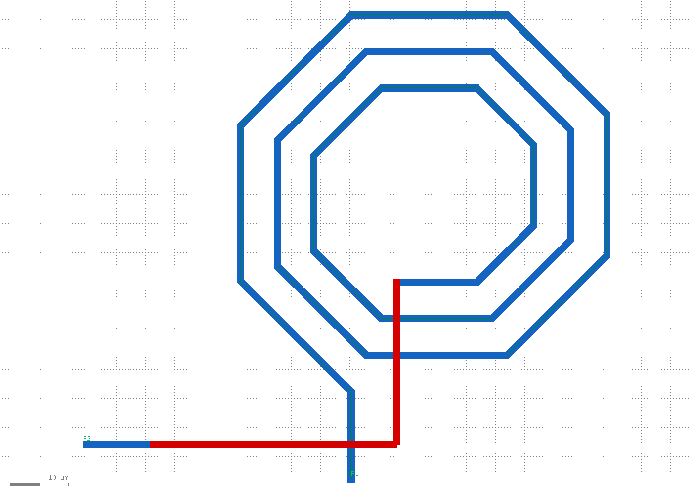

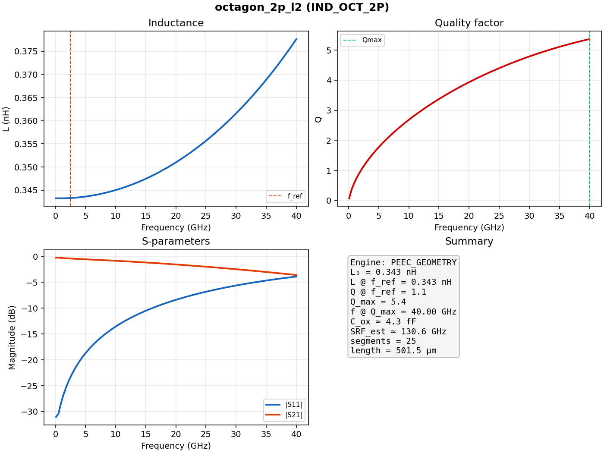

| Field | Value |
|-------|-------|
| Cell | `IND_OCT_2P` |
| Shape / ports / role | octagon / 2 / inductor |
| Width / space | 1.0 / 1.0 µm |
| Turns / rin | 3.0 / 18.0 µm |
| DRC / LVS / SHORTS | PASS / PASS / PASS |
| EM engine | PEEC_GEOMETRY |
| L₀ | 0.343 nH |
| L @ f_ref | 0.343 nH |
| Q @ f_ref | 1.14 |
| Q_max | 5.37 @ 40.00 GHz |
| C_ox | 4.33 fF |
| SRF_est | 130.6 GHz |
| Segments / length | 25 / 501.5 µm |
| RESULT | [6/RESULT.md](6/RESULT.md) |

### Run 7 — `octagon_3p_ct_l2`

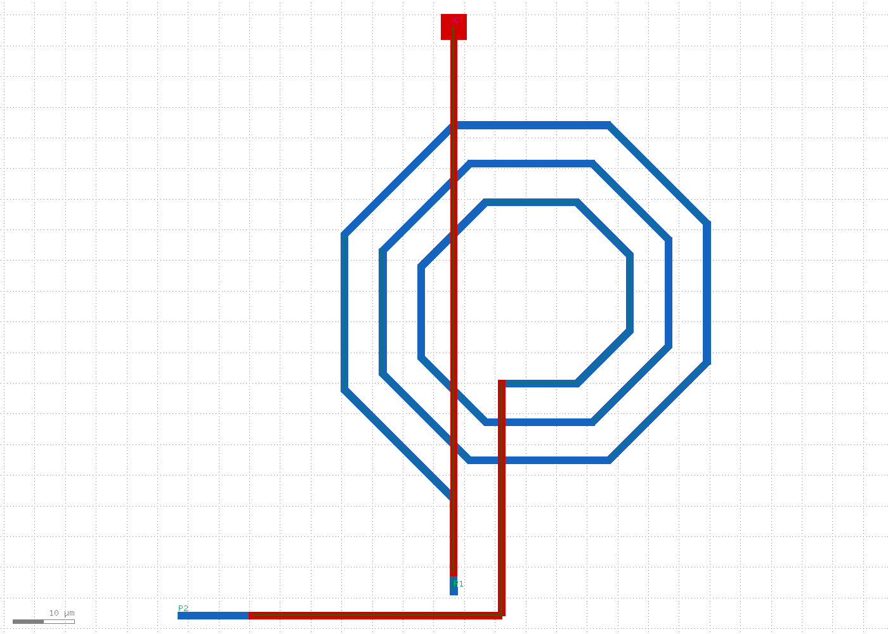

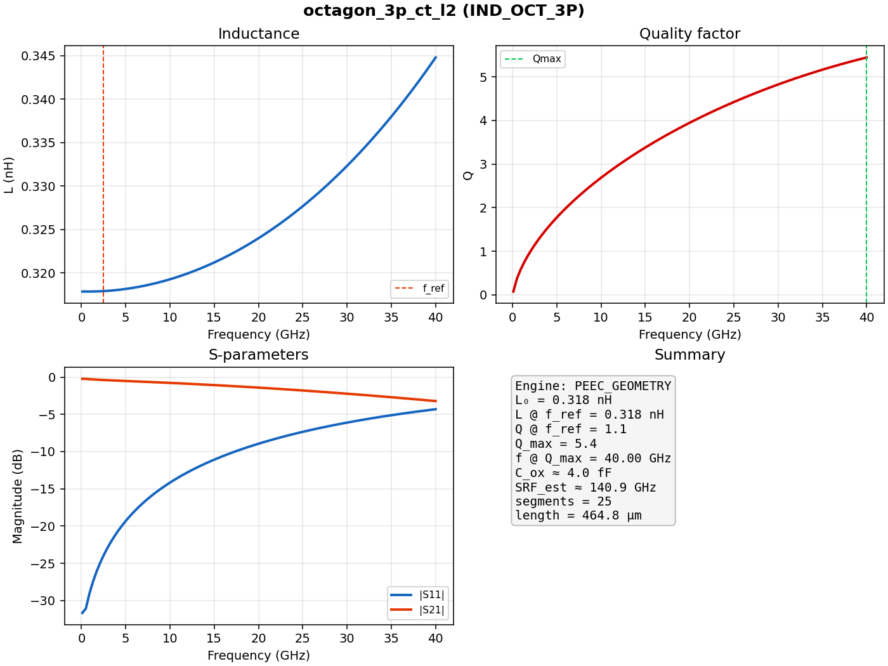

| Field | Value |
|-------|-------|
| Cell | `IND_OCT_3P` |
| Shape / ports / role | octagon / 3 / inductor |
| Width / space | 1.0 / 1.0 µm |
| Turns / rin | 3.0 / 16.0 µm |
| DRC / LVS / SHORTS | PASS / PASS / PASS |
| EM engine | PEEC_GEOMETRY |
| L₀ | 0.318 nH |
| L @ f_ref | 0.318 nH |
| Q @ f_ref | 1.14 |
| Q_max | 5.44 @ 40.00 GHz |
| C_ox | 4.01 fF |
| SRF_est | 140.9 GHz |
| Segments / length | 25 / 464.8 µm |
| RESULT | [7/RESULT.md](7/RESULT.md) |

### Run 8 — `square_4p_coup_l2`

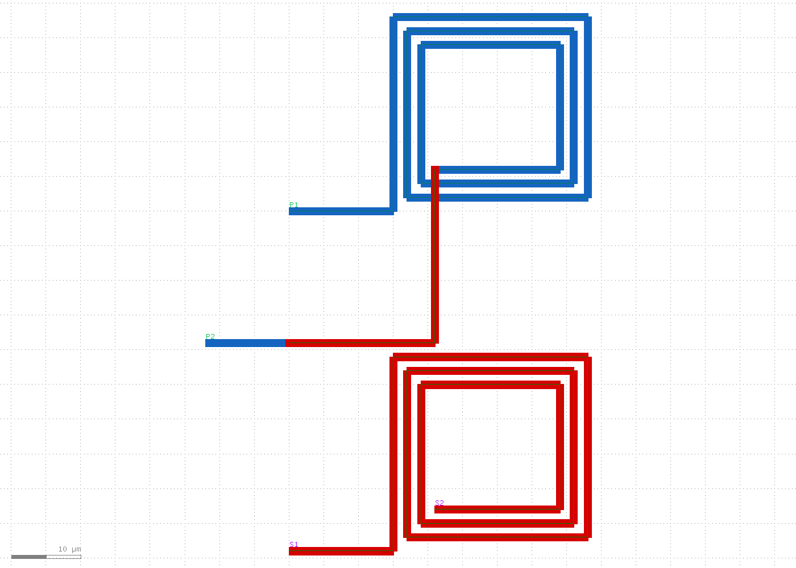

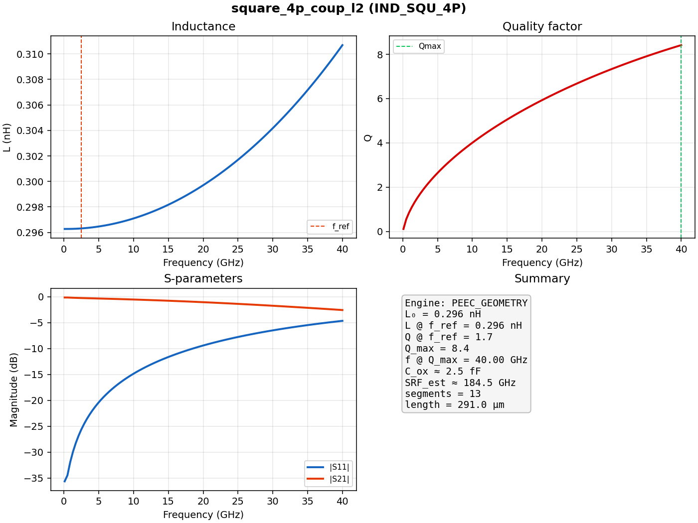

| Field | Value |
|-------|-------|
| Cell | `IND_SQU_4P` |
| Shape / ports / role | square / 4 / coupler |
| Width / space | 1.0 / 1.0 µm |
| Turns / rin | 3.0 / 18.0 µm |
| DRC / LVS / SHORTS | PASS / PASS / PASS |
| EM engine | PEEC_GEOMETRY |
| L₀ | 0.296 nH |
| L @ f_ref | 0.296 nH |
| Q @ f_ref | 1.70 |
| Q_max | 8.41 @ 40.00 GHz |
| C_ox | 2.51 fF |
| SRF_est | 184.5 GHz |
| Segments / length | 13 / 291.0 µm |
| RESULT | [8/RESULT.md](8/RESULT.md) |

### Run 9 — `circle_3p_ct_l2`

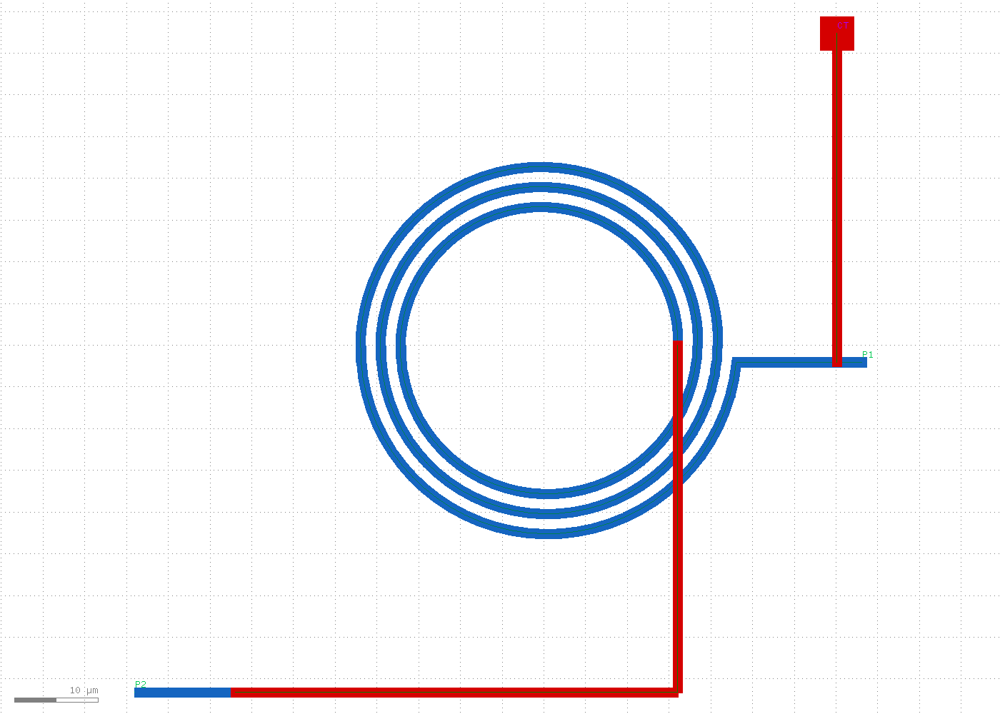

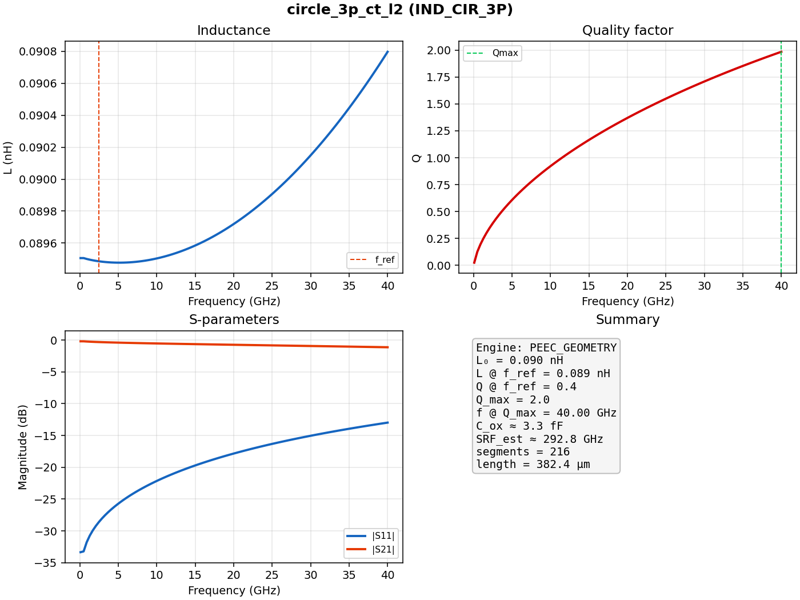

| Field | Value |
|-------|-------|
| Cell | `IND_CIR_3P` |
| Shape / ports / role | circle / 3 / inductor |
| Width / space | 1.0 / 1.0 µm |
| Turns / rin | 3.0 / 16.0 µm |
| DRC / LVS / SHORTS | PASS / PASS / PASS |
| EM engine | PEEC_GEOMETRY |
| L₀ | 0.090 nH |
| L @ f_ref | 0.089 nH |
| Q @ f_ref | 0.39 |
| Q_max | 1.98 @ 40.00 GHz |
| C_ox | 3.30 fF |
| SRF_est | 292.8 GHz |
| Segments / length | 216 / 382.4 µm |
| RESULT | [9/RESULT.md](9/RESULT.md) |

---

*Do not edit this file by hand — it is overwritten by `update_benchmark.py` after each create-inductor run.*
