# NMOS Transistor LVS Demo (KLayout)

Minimal **Layout vs Schematic**: extract one NMOS with `mos4`, compare to SPICE.

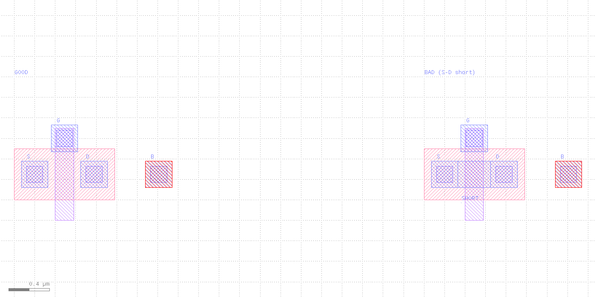

| Cell | Layout | Expected |
|------|--------|----------|
| `NMOS_GOOD` | Correct S / G / D / B | **PASS** |
| `NMOS_BAD` | Metal shorts S–D | **FAIL** |
| `NMOS_DEMO` | Both (for viewing) | — |

Device: **L = 0.18 µm**, **W = 0.50 µm** (matches `nmos.cir`).

Sibling demos: [`../drc/`](../drc/) (M1 / Contact DRC) · [`../pex/`](../pex/) (M1 R extraction).

---

## Quick start

```bash
cd lvs
./run_lvs.sh              # GOOD → PASS, BAD → FAIL
./run_lvs.sh --good       # GOOD only
./run_lvs.sh --bad        # BAD only (expect FAIL)

./view_lvs.sh             # GUI + GOOD LVS DB
./view_lvs.sh --bad

./run_clean.sh
```

Requires [KLayout](https://www.klayout.de/) on `PATH` (`../scripts/install-klayout.sh`).

```bash
klayout -b \
  -rd input=nmos_demo.gds \
  -rd cell=NMOS_GOOD \
  -rd schematic=nmos.cir \
  -rd lvsdb=nmos_good.lvsdb \
  -r transistor.lvs
```

---

## Files

| File | Role |
|------|------|
| `generate_layout.rb` | Builds `nmos_demo.gds` (GOOD + BAD + DEMO) |
| `nmos_demo.gds` | Test layout |
| `nmos.cir` | Reference SPICE (subcircuits match cell names) |
| `transistor.lvs` | Extract + connect + `compare` |
| `run_lvs.sh` | Generate + run GOOD/BAD |
| `view_lvs.sh` | `klayout gds -mn lvsdb` |
| `run_clean.sh` | Delete reports / extracted netlists (`--gds` removes GDS) |

Generated (gitignored): `nmos_{good,bad}.{lvsdb,l2ndb,log}`, `nmos_*_extracted.cir`

---

## Layers

| GDS | Name | Screenshot color | Role |
|-----|------|------------------|------|
| 1/0 | DIFF | red | n-active |
| 2/0 | POLY | green | gate |
| 3/0 | CONT | yellow | contacts |
| 4/0 | METAL1 | blue | routing |
| 4/1 | labels | purple | net names S / G / D / B |
| 6/0 | PTIE | orange | substrate tap (bulk) |

---

## How `transistor.lvs` works

### Derived layers

```ruby
gate = diff & poly    # channel
nsd  = diff - poly    # source / drain
```

### Extract MOS4

```ruby
bulk = polygon_layer   # empty — terminal provisioning only (KLayout manual style)

extract_devices(mos4("NMOS"), {
  "SD" => nsd, "G" => gate, "W" => bulk,
  "tS" => nsd, "tD" => nsd, "tG" => poly, "tW" => bulk
})
```

### Connectivity

```ruby
connect(nsd, cont)
connect(poly, cont)
connect(ptie, cont)
connect(cont, metal1)
connect(metal1, m1_lbl)

connect_global(bulk, "SUBSTRATE")
connect_global(ptie, "SUBSTRATE")   # body tap → pin B
```

Do **not** draw a bulk polygon under S/G/D contacts — every contact would short through bulk.

### Compare

```ruby
schematic("nmos.cir")
align
netlist.simplify
ok = compare
puts ok ? "LVS PASS — ..." : "LVS FAIL — ..."
```

Reference:

```spice
.SUBCKT NMOS_GOOD S G D B
M1 D G S B NMOS L=0.18U W=0.50U
.ENDS
```

(`NMOS_BAD` uses the same device connectivity in the schematic; the layout short causes the mismatch.)

---

## Good vs bad extraction

| GOOD (`NMOS_GOOD`) | BAD (`NMOS_BAD`) |
|:------------------:|:----------------:|
| 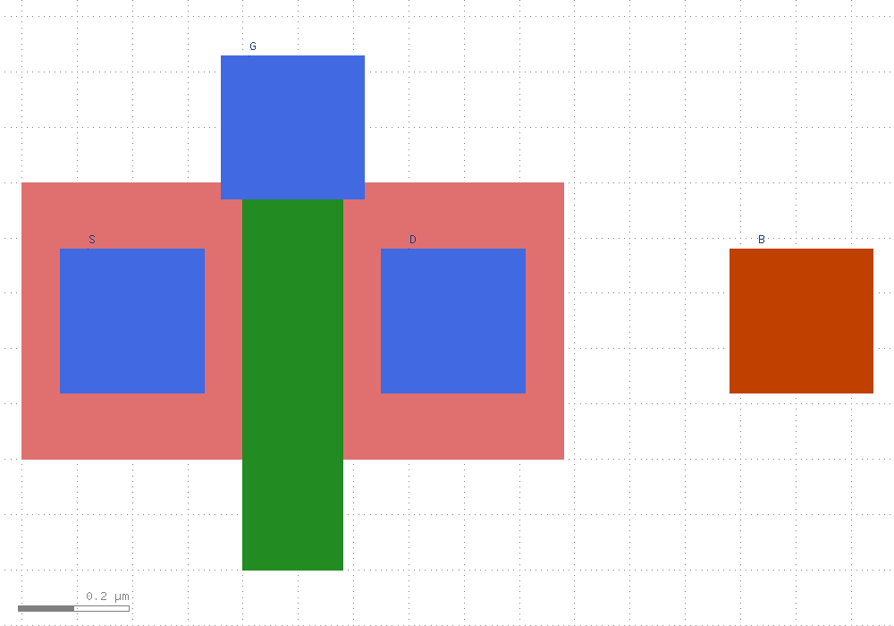 | 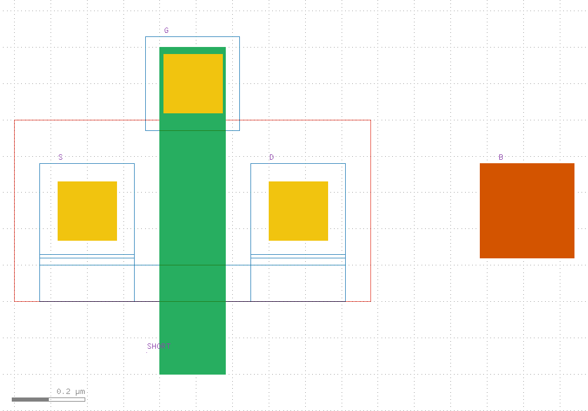 |
| Separate S / G / D / B | Metal strap shorts S–D |

| GOOD terminals + L/W | BAD + short highlight |
|:--------------------:|:---------------------:|
| 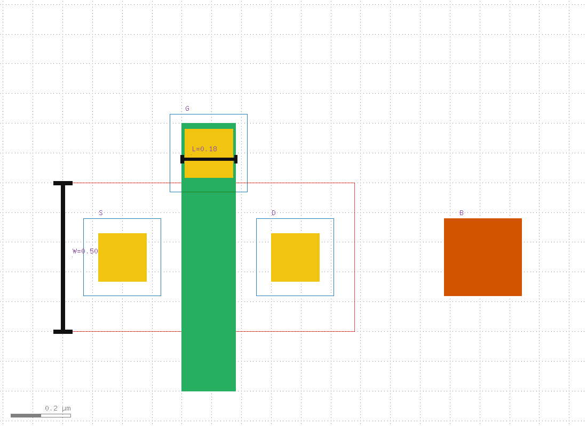 | 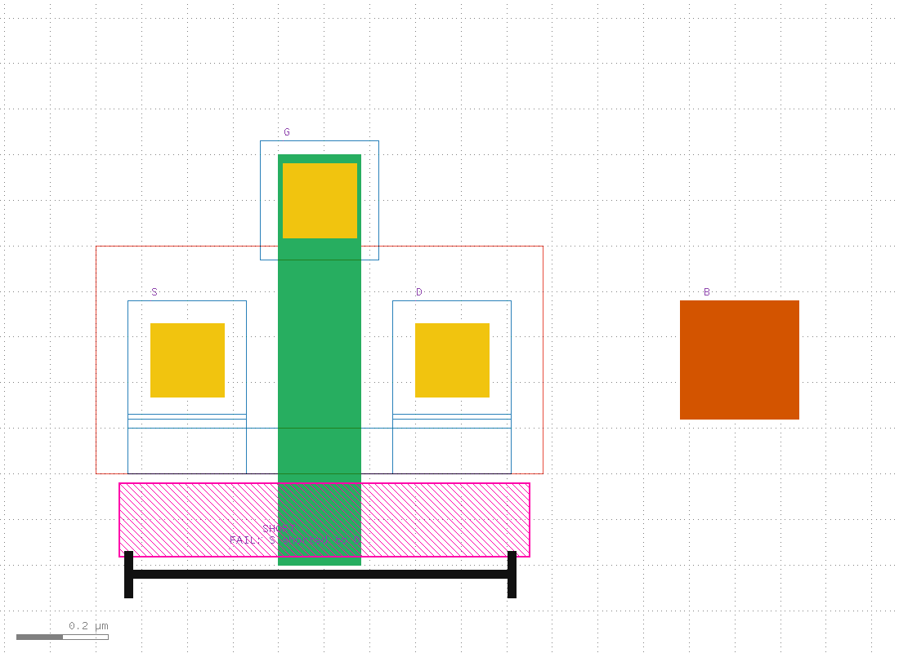 |

**GOOD** — four nets:

```spice
* pin G / S / D / B
M$1 3 1 2 4 NMOS L=0.18U W=0.5U    # D G S B
```

**BAD** — S and D merged:

```spice
* pin G / D,S / B
M$1 2 1 2 3 NMOS L=0.18U W=0.5U    # S/D shorted → FAIL
```

---

## Per-feature zoom (rulers + markers)

Same style as [`../drc/`](../drc/) — zoomed shots with dimension labels. BAD cases highlight the S–D metal bridge (magenta).

### Channel L / W (matches schematic)

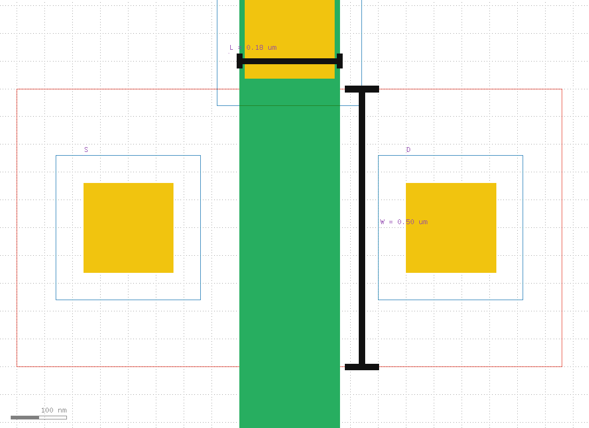

### Terminals (GOOD)

| Gate | Source | Drain | Bulk |
|:----:|:------:|:-----:|:----:|
| 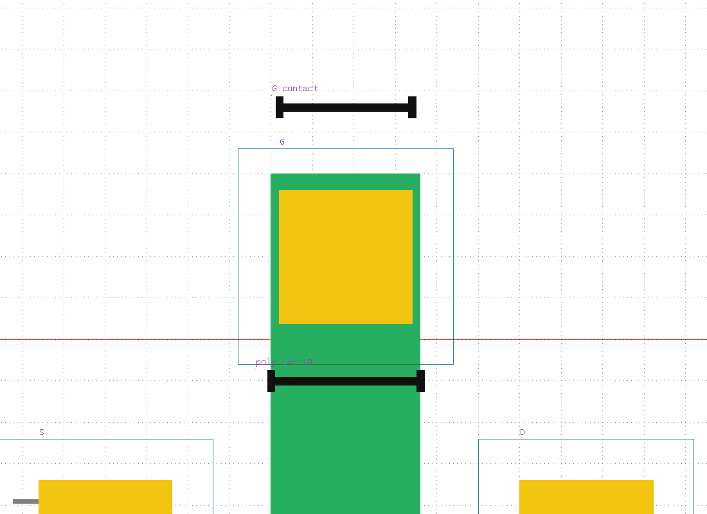 | 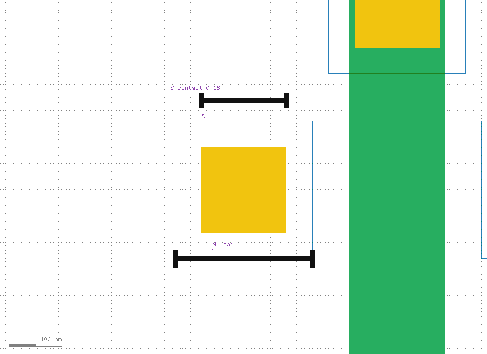 | 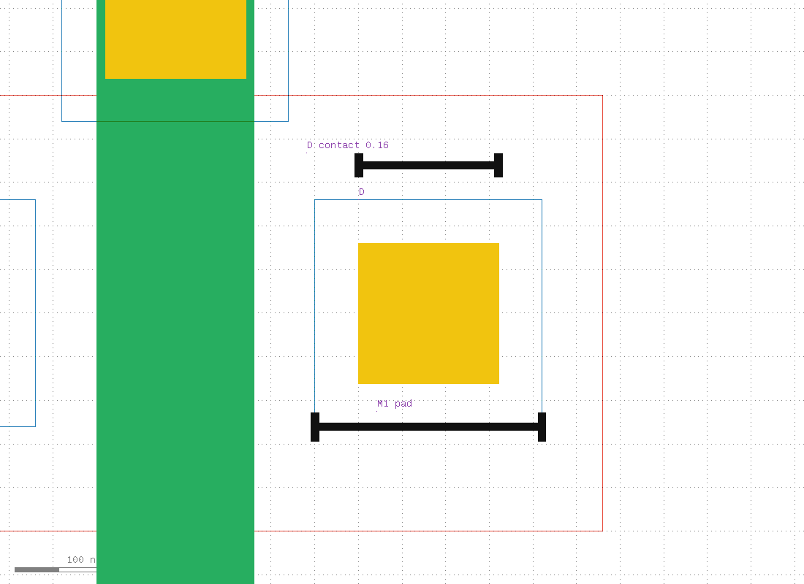 | 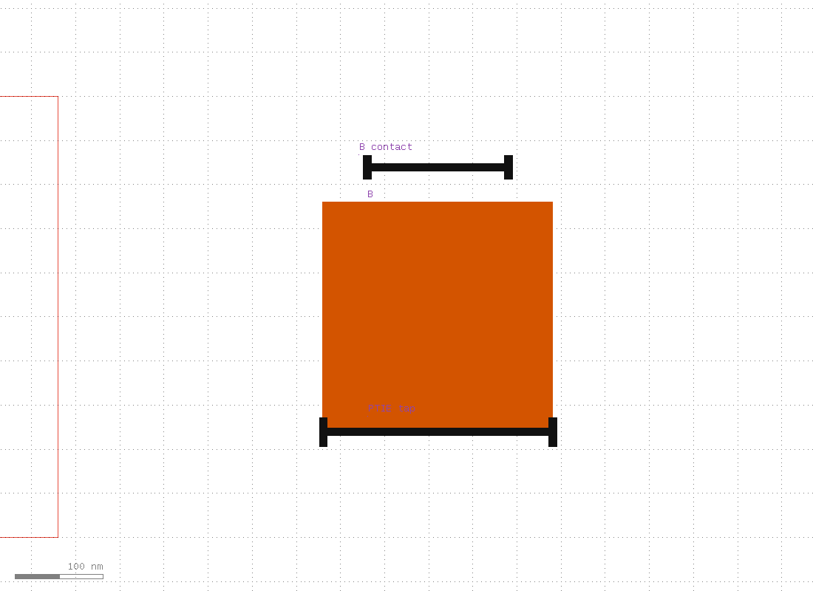 |

### S–D connectivity

| GOOD — open (no bridge) | BAD — metal short |
|:-----------------------:|:-----------------:|
| 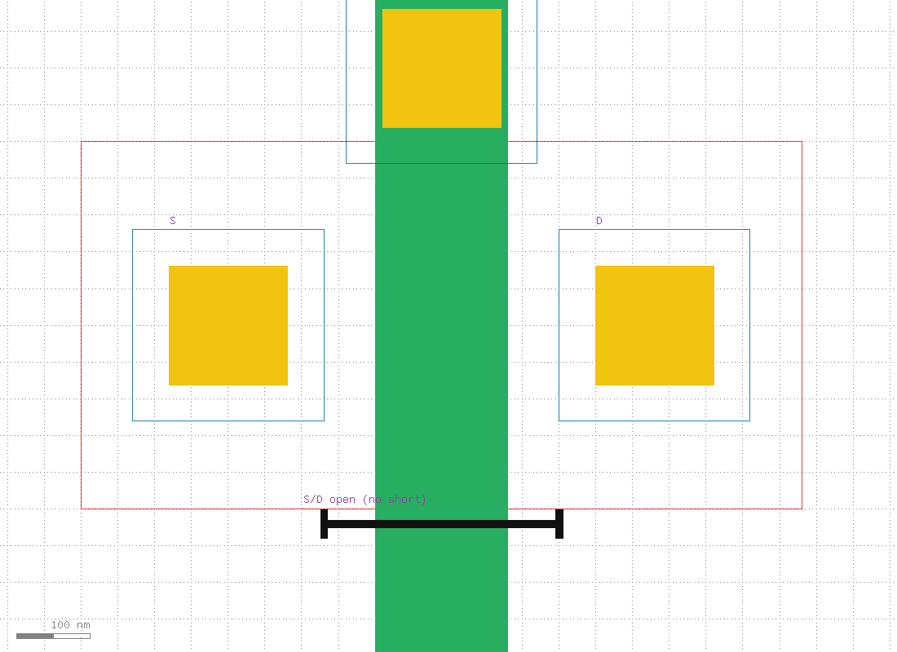 | 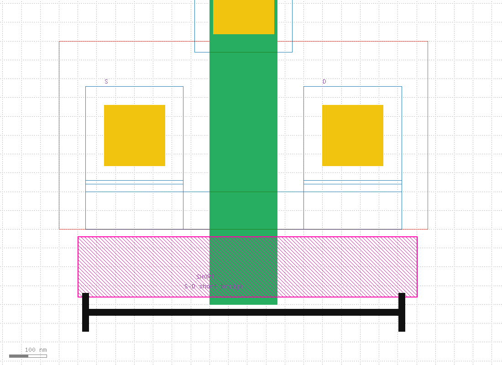 |

---

## Screenshots

```bash
../scripts/run_capture_screenshots.sh   # regenerate GDS + LVS + all PNGs
```

| File | Content |
|------|---------|
| [`../screenshots/lvs_nmos_demo.png`](../screenshots/lvs_nmos_demo.png) | GOOD + BAD side by side |
| [`../screenshots/lvs_nmos_good.png`](../screenshots/lvs_nmos_good.png) | Passing transistor |
| [`../screenshots/lvs_nmos_bad.png`](../screenshots/lvs_nmos_bad.png) | Failing S–D short |
| `lvs_case_*.png` | Per-feature zoom with rulers / markers (see above) |

---

## See also

- [`../docs/LVS.md`](../docs/LVS.md) — KLayout LVS reference  
- [`../drc/`](../drc/) — M1 / Contact DRC (KLayout + Calibre)  
- [`../pex/`](../pex/) — M1 resistor PEX  
- [KLayout LVS introduction](https://www.klayout.de/doc-qt5/manual/lvs_intro.html)
