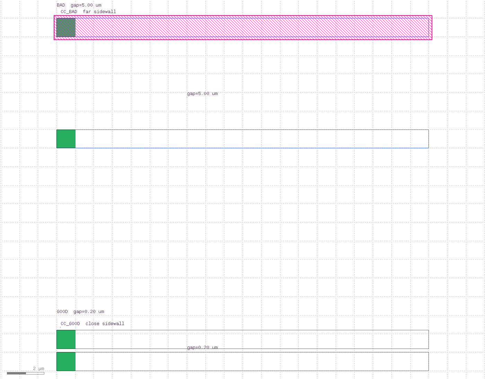
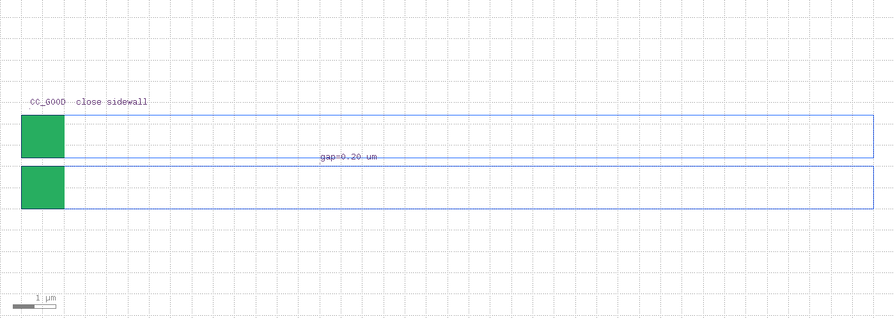
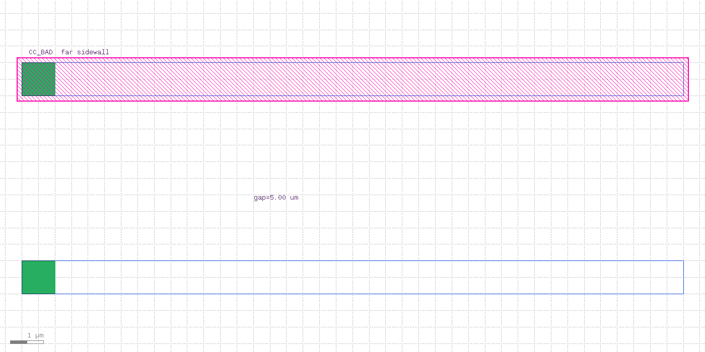
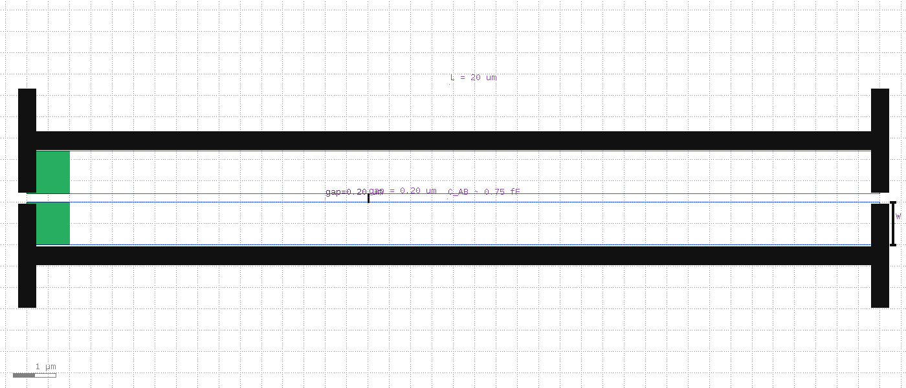
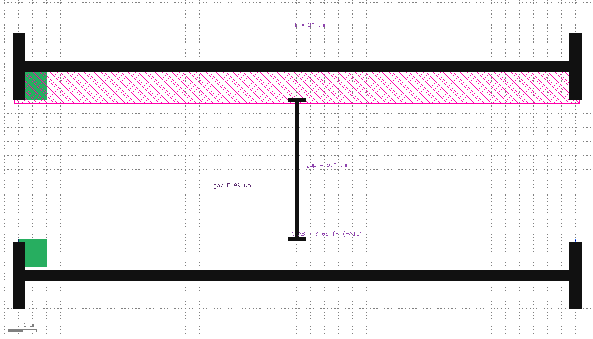

# PEX Demo — R / C (KLayout) + CC (KLayout-PEX)

Educational parasitic extraction with the same GOOD pass / BAD fail pattern as [`../drc/`](../drc/) and [`../lvs/`](../lvs/).

| What | Tool | Formula / engine |
|------|------|------------------|
| **R** | Built-in `RNetExtractor` | `R ≈ (L/W) × sheet_r` |
| **C** | LVS `capacitor()` | `C = A_overlap × area_cap` |
| **CC** | [KLayout-PEX](https://iic-jku.github.io/klayout-pex-website/doc/doc.html) `kpex --2.5D` | sidewall / fringe / substrate (sky130A) |

> Built-in `klayout.pex` is **R-only**. Overlap **C** uses LVS `capacitor()`. Full coupling **CC** (sidewall) needs **kpex**.




### Resistance

| Cell | Layout | Squares | R (@ 0.08 Ω/□) | Result |
|------|--------|---------|----------------|--------|
| `R_GOOD` | L=2.0, W=1.0 µm | 2 | **0.16 Ω** | **PASS** (R < 1.0) |
| `R_BAD` | L=16.0, W=0.20 µm | 80 | **6.40 Ω** | **FAIL** |

### Capacitance (overlap)

| Cell | Overlap | C (@ 1e-15 F/µm²) | Result |
|------|---------|-------------------|--------|
| `C_GOOD` | 3×3 = 9 µm² | **9.0 fF** | **PASS** (C ≥ 1 fF) |
| `C_BAD` | 0.5×0.5 = 0.25 µm² | **0.25 fF** | **FAIL** |

### Coupling capacitance (kpex / sky130A li1)

| Cell | Geometry | C_AB (typical) | Result |
|------|----------|----------------|--------|
| `CC_GOOD` | L=20 µm, W=1 µm, **gap=0.20 µm** | **~0.75 fF** | **PASS** (C_AB ≥ 0.30 fF) |
| `CC_BAD` | same, **gap=5.0 µm** | **~0.05 fF** | **FAIL** |

Sibling demos: [`../drc/`](../drc/) · [`../lvs/`](../lvs/).

---

## Quick start

### Built-in R + C

```bash
cd pex
./run_pex.sh              # R + C, GOOD/BAD
./run_pex.sh --r          # resistance only
./run_pex.sh --c          # capacitance only
./run_pex.sh --good
./run_pex.sh --bad

./view_pex.sh             # R_GOOD report + GDS
./view_pex.sh --c
./view_pex.sh --c-bad
./view_pex.sh --demo

./run_clean.sh
```

Requires KLayout **0.30.2+** for `RNetExtractor` (`../scripts/install-klayout.sh`).

### KLayout-PEX (CC)

```bash
# once
../scripts/install_kpex.sh          # needs Python >= 3.12

cd pex
./run_kpex.sh                       # CC_GOOD PASS + CC_BAD FAIL
./run_kpex.sh --good
./run_kpex.sh --bad
./run_kpex.sh --plate               # also C_PLATE (li1 → substrate)

# outputs: cc_good.txt / cc_bad.txt / cc_*_extracted.cir / kpex_out/
```

`kpex --2.5D` uses only KLayout (no MAGIC / FasterCap required). MAGIC engine needs magic ≥ 8.3.679.
```bash
# R
klayout -b -rd input=pex_demo.gds -rd cell=R_GOOD \
  -rd report=r_good.txt -rd spice=r_good_extracted.cir \
  -rd sheet_r=0.08 -rd r_limit=1.0 -r extract_r.rb

# C
klayout -b -rd input=pex_demo.gds -rd cell=C_GOOD \
  -rd report=c_good.txt -rd spice=c_good_extracted.cir \
  -rd area_cap=1e-15 -rd c_limit=1e-15 -r extract_c.lvs
```

---

## Files

| File | Role |
|------|------|
| `generate_layout.rb` | Builds `pex_demo.gds` (R_* + C_* + demos) |
| `generate_kpex_layout.rb` | Builds `kpex_demo.gds` (CC_* + C_PLATE, sky130A li1) |
| `extract_r.rb` | `RNetExtractor` + PASS/FAIL vs `r_limit` |
| `extract_c.lvs` | `capacitor()` + PASS/FAIL vs `c_limit` |
| `run_pex.sh` | Generate + run R/C GOOD/BAD |
| `run_kpex.sh` | Generate + run kpex 2.5D CC GOOD/BAD |
| `view_pex.sh` | Open GDS + show report |
| `run_clean.sh` | Delete reports / spice / `kpex_out/` (`--gds` removes GDS) |
| `../scripts/install_kpex.sh` | `pip install --user klayout-pex` (Python ≥ 3.12) |

Generated (gitignored): `r_*.{txt,log,cir}`, `c_*.{txt,log,cir}`, `cc_*.{txt,log,cir}`, `pex_demo.gds`, `kpex_demo.gds`, `kpex_out/`

---

## Layers

### Built-in R / C (`pex_demo.gds`)

| GDS | Name | Color | Role |
|-----|------|-------|------|
| 31/0 | M1 | blue | resistor metal / capacitor bottom plate |
| 32/0 | M2 | green | capacitor top plate |
| 90/0 | labels | purple | A/B / titles |
| 100/0 | marker | magenta | BAD highlight (screenshots) |

### kpex CC (`kpex_demo.gds`, sky130A)

| GDS | Name | Role |
|-----|------|------|
| 67/20 | li1 | metal drawing |
| 67/16 | li1 pin | pin polygons |
| 67/5 | li1 label | net names `A` / `B` / `PLATE` |
| 90/0 | annotation | titles |
| 100/0 | marker | BAD highlight |

---

## How extraction works

### R — `RNetExtractor`

```ruby
tech = RExtractorTech.new
cond = RExtractorTechConductor.new
cond.layer = 31
cond.resistance = 0.08
cond.algorithm = RExtractorTechConductor::SquareCounting
tech.add_conductor(cond)

network = RNetExtractor.new(dbu).extract(tech, geo, {}, polygon_ports)
# PASS if R < r_limit
```

### C — `capacitor()` (LVS device extractor)

```ruby
metal1 = input(31, 0)
metal2 = input(32, 0)
extract_devices(capacitor("CAP", 1e-15), { "P1" => metal1, "P2" => metal2 })
# C = overlap_area × 1e-15 F/µm²
# PASS if C >= c_limit
```

SPICE snippets:

```spice
.SUBCKT R_GOOD A B
R1 A B 0.16
.ENDS

.SUBCKT C_GOOD A B
C1 A B 9e-15
.ENDS
```

### CC — `kpex extract --2.5D` (sky130A)

```bash
kpex extract --pdk sky130A --2.5D \
  --gds kpex_demo.gds --cell CC_GOOD --out_dir kpex_out/good
# → *_k25d_pex_netlist.spice / .csv
```

Typical netlist:

```spice
.SUBCKT CC_GOOD sky130_gnd
Cext_1 A B 750a          ; coupling (~0.75 fF)
Cext_2 A sky130_gnd 1.72f
Cext_3 B sky130_gnd 1.72f
.ENDS
```

PASS if coupling `C_AB >= CC_LIMIT_FF` (default **0.30 fF**).

---

## Good vs bad

### Resistance

| GOOD | BAD |
|:----:|:---:|
|  |  |
|  |  |

### Capacitance (overlap)

| GOOD (full overlap) | BAD (misaligned) |
|:-------------------:|:----------------:|
|  |  |
|  |  |

### Coupling (kpex)

| GOOD (gap 0.20 µm) | BAD (gap 5.0 µm) |
|:------------------:|:----------------:|
|  |  |
|  |  |

---

## Screenshots

```bash
../scripts/run_capture_screenshots.sh
```

| File | Content |
|------|---------|
| `pex_r_demo.png` / `pex_c_demo.png` / `pex_cc_demo.png` | R / C / CC overviews |
| `pex_r_*.png` / `pex_c_*.png` / `pex_cc_*.png` | Cell views |
| `pex_case_*.png` | Zoom + rulers / markers |

---

## See also

- [`../docs/PEX.md`](../docs/PEX.md) — `RExtractor` / `RNetExtractor` reference  
- [`../docs/LVS.md`](../docs/LVS.md) — `capacitor` / `capacitor_with_bulk`  
- [`../drc/`](../drc/) · [`../lvs/`](../lvs/)  
- [KLayout-PEX](https://iic-jku.github.io/klayout-pex-website/doc/doc.html) — full parasitic C / CC engine  
