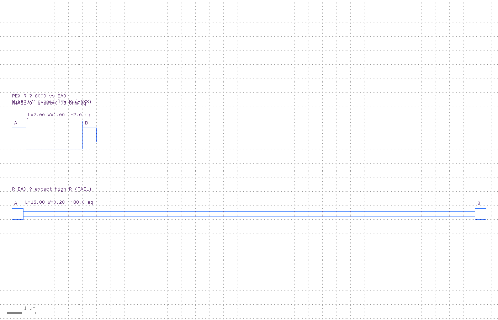
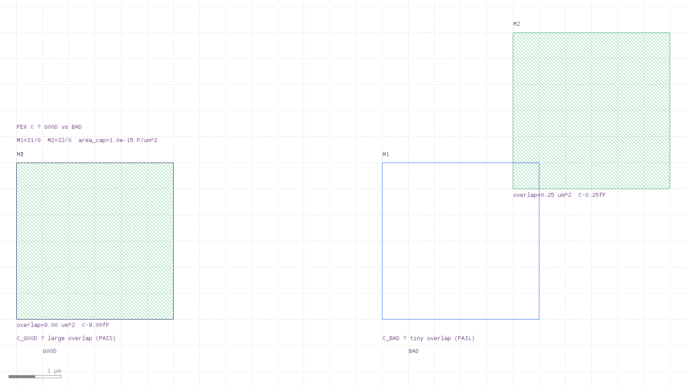
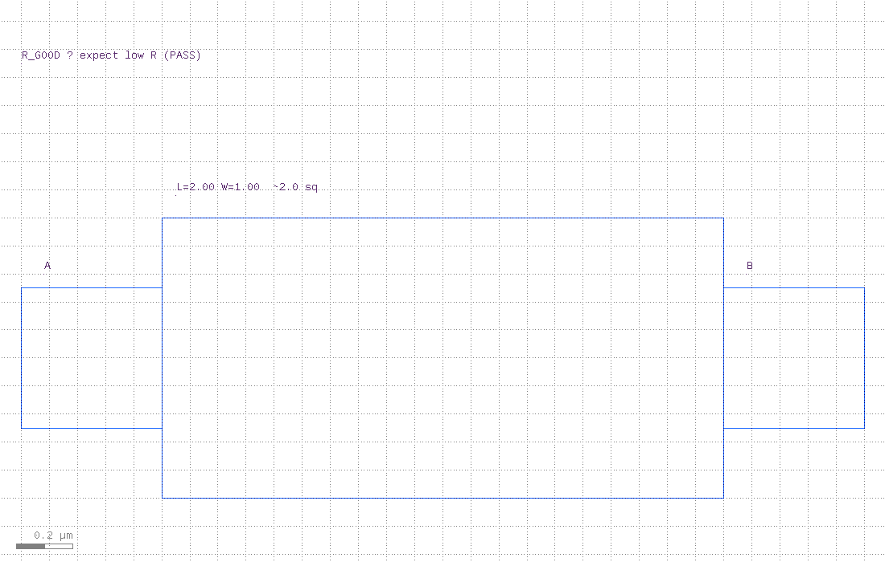
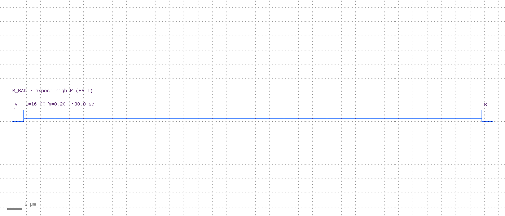
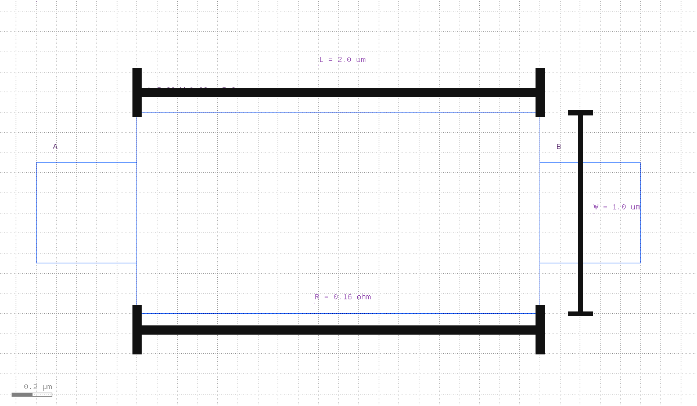
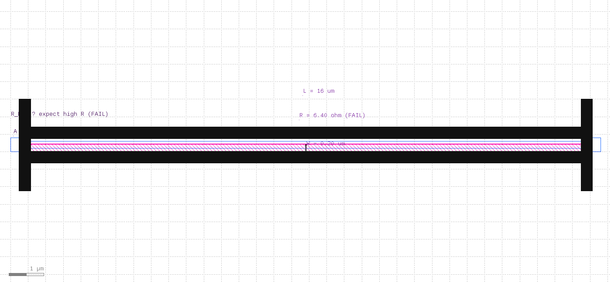
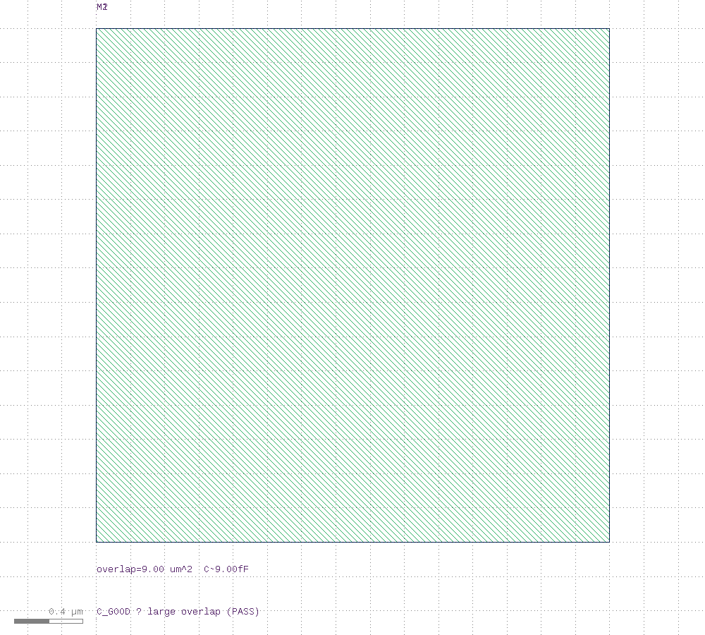
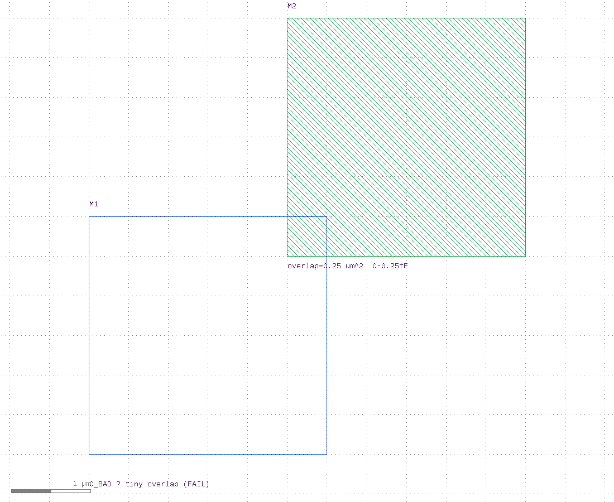
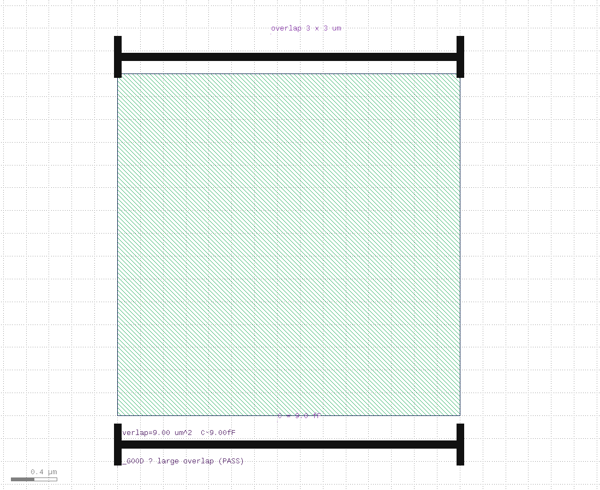
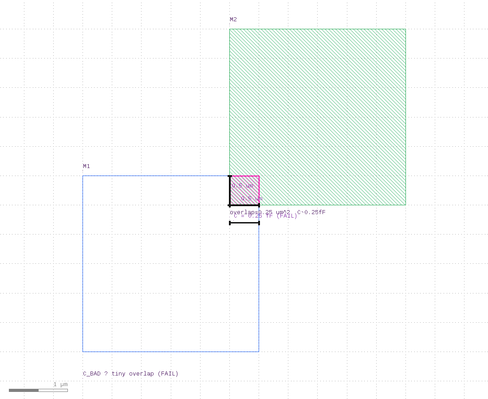

# M1 Resistor + Parallel-Plate Capacitor PEX Demo (KLayout)

Educational **R** and **C** extraction — same GOOD pass / BAD fail pattern as [`../drc/`](../drc/) and [`../lvs/`](../lvs/).

| What | API | Formula |
|------|-----|---------|
| **R** | Built-in `RNetExtractor` (square counting) | `R ≈ (L/W) × sheet_r` |
| **C** | LVS `capacitor()` device extractor | `C = A_overlap × area_cap` |

> The built-in `klayout.pex` module is **R-only**. Full parasitic C (sidewall / fringe / 2.5D) needs [KLayout-PEX (`kpex`)](https://iic-jku.github.io/klayout-pex-website/doc/doc.html). This demo teaches the **overlap-area capacitor** extractor that ships with KLayout LVS.





### Resistance

| Cell | Layout | Squares | R (@ 0.08 Ω/□) | Result |
|------|--------|---------|----------------|--------|
| `R_GOOD` | L=2.0, W=1.0 µm | 2 | **0.16 Ω** | **PASS** (R < 1.0) |
| `R_BAD` | L=16.0, W=0.20 µm | 80 | **6.40 Ω** | **FAIL** |

### Capacitance

| Cell | Overlap | C (@ 1e-15 F/µm²) | Result |
|------|---------|-------------------|--------|
| `C_GOOD` | 3×3 = 9 µm² | **9.0 fF** | **PASS** (C ≥ 1 fF) |
| `C_BAD` | 0.5×0.5 = 0.25 µm² | **0.25 fF** | **FAIL** |

Sibling demos: [`../drc/`](../drc/) · [`../lvs/`](../lvs/).

---

## Quick start

```bash
cd pex
./run_pex.sh              # R + C, GOOD/BAD
./run_pex.sh --r          # resistance only
./run_pex.sh --c          # capacitance only
./run_pex.sh --good
./run_pex.sh --bad

./view_pex.sh             # R_GOOD report + GDS
./view_pex.sh --c
./view_pex.sh --c-bad
./view_pex.sh --demo

./run_clean.sh
```

Requires KLayout **0.30.2+** for `RNetExtractor` (`../scripts/install-klayout.sh`).

```bash
# R
klayout -b -rd input=pex_demo.gds -rd cell=R_GOOD \
  -rd report=r_good.txt -rd spice=r_good_extracted.cir \
  -rd sheet_r=0.08 -rd r_limit=1.0 -r extract_r.rb

# C
klayout -b -rd input=pex_demo.gds -rd cell=C_GOOD \
  -rd report=c_good.txt -rd spice=c_good_extracted.cir \
  -rd area_cap=1e-15 -rd c_limit=1e-15 -r extract_c.lvs
```

---

## Files

| File | Role |
|------|------|
| `generate_layout.rb` | Builds `pex_demo.gds` (R_* + C_* + demos) |
| `extract_r.rb` | `RNetExtractor` + PASS/FAIL vs `r_limit` |
| `extract_c.lvs` | `capacitor()` + PASS/FAIL vs `c_limit` |
| `run_pex.sh` | Generate + run R/C GOOD/BAD |
| `view_pex.sh` | Open GDS + show report |
| `run_clean.sh` | Delete reports / spice (`--gds` removes GDS) |

Generated (gitignored): `r_*.{txt,log,cir}`, `c_*.{txt,log,cir}`, `pex_demo.gds`

---

## Layers

| GDS | Name | Color | Role |
|-----|------|-------|------|
| 31/0 | M1 | blue | resistor metal / capacitor bottom plate |
| 32/0 | M2 | green | capacitor top plate |
| 90/0 | labels | purple | A/B / titles |
| 100/0 | marker | magenta | BAD highlight (screenshots) |

---

## How extraction works

### R — `RNetExtractor`

```ruby
tech = RExtractorTech.new
cond = RExtractorTechConductor.new
cond.layer = 31
cond.resistance = 0.08
cond.algorithm = RExtractorTechConductor::SquareCounting
tech.add_conductor(cond)

network = RNetExtractor.new(dbu).extract(tech, geo, {}, polygon_ports)
# PASS if R < r_limit
```

### C — `capacitor()` (LVS device extractor)

```ruby
metal1 = input(31, 0)
metal2 = input(32, 0)
extract_devices(capacitor("CAP", 1e-15), { "P1" => metal1, "P2" => metal2 })
# C = overlap_area × 1e-15 F/µm²
# PASS if C >= c_limit
```

SPICE snippets:

```spice
.SUBCKT R_GOOD A B
R1 A B 0.16
.ENDS

.SUBCKT C_GOOD A B
C1 A B 9e-15
.ENDS
```

---

## Good vs bad

### Resistance

| GOOD | BAD |
|:----:|:---:|
|  |  |
|  |  |

### Capacitance

| GOOD (full overlap) | BAD (misaligned) |
|:-------------------:|:----------------:|
|  |  |
|  |  |

---

## Screenshots

```bash
../scripts/run_capture_screenshots.sh
```

| File | Content |
|------|---------|
| `pex_r_demo.png` / `pex_c_demo.png` | R / C overviews |
| `pex_r_*.png` / `pex_c_*.png` | Cell views |
| `pex_case_*.png` | Zoom + rulers / markers |

---

## See also

- [`../docs/PEX.md`](../docs/PEX.md) — `RExtractor` / `RNetExtractor` reference  
- [`../docs/LVS.md`](../docs/LVS.md) — `capacitor` / `capacitor_with_bulk`  
- [`../drc/`](../drc/) · [`../lvs/`](../lvs/)  
- [KLayout-PEX](https://iic-jku.github.io/klayout-pex-website/doc/doc.html) — full parasitic C engine  
